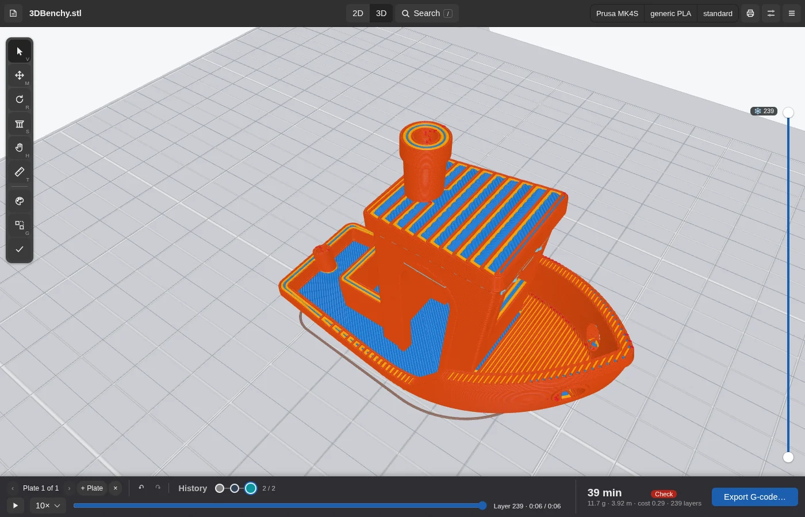
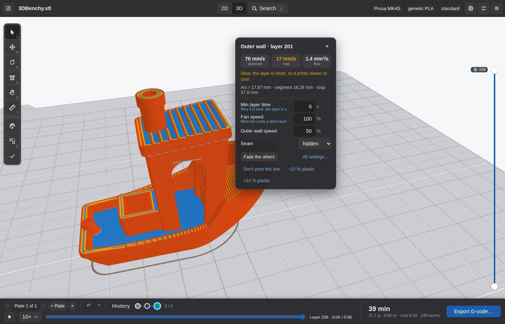
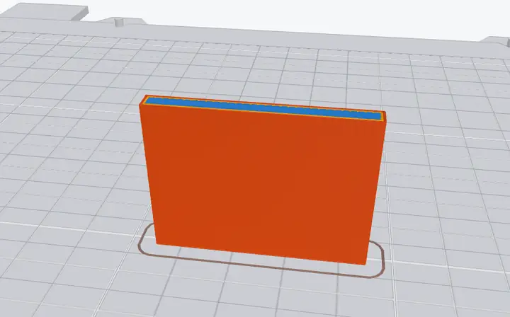
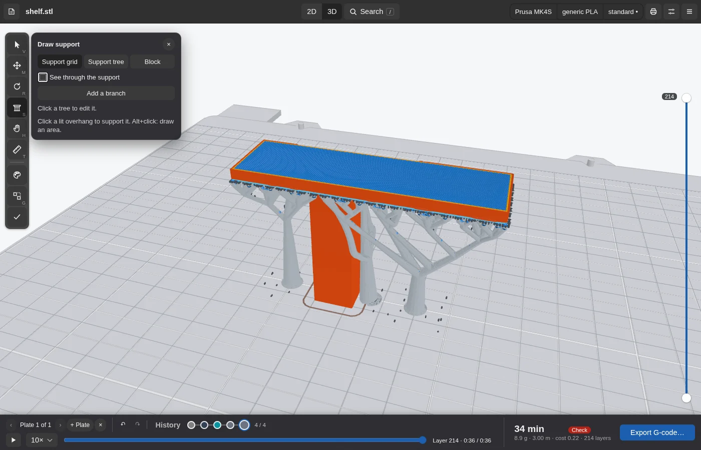
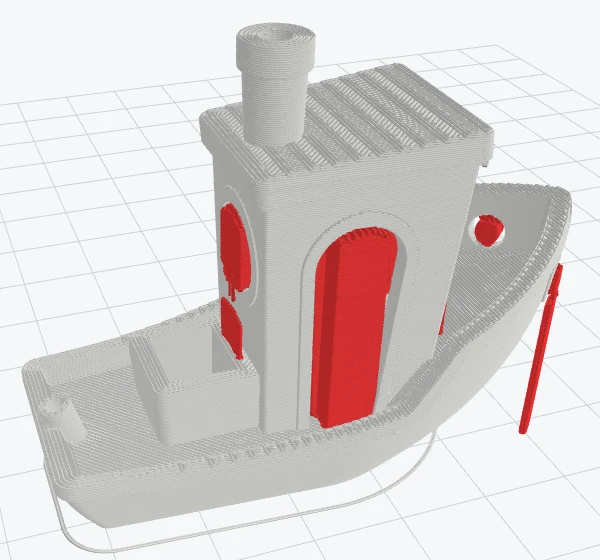

# zslice



zslice is a slicer for FDM 3D printers, written from scratch in Zig. It shows the print as the plastic forms it, before you print.

- **In your browser:** **[open zslice.beetlebug.org](https://zslice.beetlebug.org/)**. No install is necessary, and your files stay on your computer.
- **On your computer:** native apps for **Linux** (GTK 4 and Vulkan), **macOS** (SwiftUI and Metal), and **Windows** (WinUI 3 and Direct3D 12). See [Install](#install).

> **zslice is an experimental slicer.** It has three goals:
> - **Very fast slicing:** a change of a setting shows in the view at once, at 60 frames a second.
> - **New ways to use a slicer:** trials of new UI and UX models, for example the slice as the whole UI, a click on a line to see why it prints as it does, and direct edits in the 3D view.
> - **Feature ideas:** for example a physical simulation of the plastic, so that the real sag of the filament shows before you print, fitted to measured test prints.
>
> Expect changes and rough edges. Check each print in the view before you send it to a printer.

## The best of it

### Speed



The view runs at 60 frames a second, and a slice keeps up with your edits. On a 3DBenchy (8 cores):

- A full slice: about 0.3 s.
- A change of a speed, the fan, a temperature, or the flow: about 15 ms. The paths stay; only the G-code is made again.
- A change of the infill: about 30 ms. A change of the walls: about 0.2 s.
- A drag of a part, a tree branch, or a setting slider shows the result as you move.

zslice keeps the work of the last slice, and makes again only what a change touches. A new change stops a slice that runs in under 15 ms.

<br clear="right">

### The print as it forms


zslice simulates the plastic as it leaves the nozzle. It cools with the fan, and it sags or falls where no plastic holds it. A bridge sags. A slab over the air falls in strands, and the next layers print on them. The physics is fitted to measured test prints, and it runs after each slice.

<br clear="left">

### Parts with real physics



A part that cannot stand falls over onto a face, as on a real bed. A brim holds a tall part up. With the Grab tool, pick a part up and move it. Let go, and it rests flat.

<br clear="right">

### A support editor



Click an overhang to put support under it. Drag the dots of tree support to move the branches. Change a support from grid to tree or a pad with one click. zslice keeps each branch within the rules.

<br clear="left">

### Colors and two nozzles



Give a part, some layers, or a painted face a filament of its own. Print the support in its own filament, so it breaks away. Take the filaments that a printer has loaded with one click. On a printer with two nozzles, such as the Bambu Lab X2D, each filament has its nozzle. See [Print in colors](https://zslice.beetlebug.org/user/filaments/).

<br clear="right">

All features: [The best features](https://zslice.beetlebug.org/user/features/).

## Start

- **In your browser:** open [zslice.beetlebug.org](https://zslice.beetlebug.org/), and read [Your first print](https://zslice.beetlebug.org/user/getting-started/).
- **On your computer:** see [Install](#install).
- **From the source:** zslice needs Zig 0.16.

```sh
zig build test                          # run the tests
zig build -Doptimize=ReleaseFast        # the command line tool: zig-out/bin/zslice
zig build web                           # the web app: zig-out/web/app
zslice slice part.stl -o part.gcode     # slice a part
```

The Linux app (GTK 4) and the macOS app (SwiftUI and Metal) are in `linux/` and `macos/`. See [Web, Linux, and Mac](https://zslice.beetlebug.org/user/apps/).

## Install

### Homebrew (macOS and Linux)

Add the tap one time:

```sh
brew tap beetlebugorg/tap
```

Then install the parts that you want:

```sh
brew install --cask zslice   # the Mac app
brew install zslice          # the command line tool (macOS and Linux)
brew install zslice-gtk      # the Linux app (GTK 4)
```

`brew upgrade` gets each new release.

### Downloads

The [releases page](https://github.com/beetlebugorg/zslice/releases) has the files of each release:

- The Mac app: `zslice-VERSION-macos-universal.dmg`, for Apple silicon and Intel. Open the dmg, and drag zslice to Applications.
- The Linux app: `zslice-gtk-VERSION-linux-x86_64.tar.gz` (or `aarch64`). It needs GTK 4.14 or later. Extract it, and run `bin/zslice-gtk`.
- The command line tool: `zslice-VERSION-<cpu>-linux-musl.tar.gz` and `zslice-VERSION-<cpu>-macos.tar.gz`.
- The web app: `zslice-VERSION-web.zip`, to serve from your own web server. The app slices with threads only when the server sends the headers `Cross-Origin-Opener-Policy: same-origin` and `Cross-Origin-Embedder-Policy: require-corp`.
- `SHA256SUMS` has the SHA-256 of each file.

## Links

- [The documentation](https://zslice.beetlebug.org/docs.html): the guide, the settings, and the internals.
- [Embedding](https://zslice.beetlebug.org/embedding/): the library from Zig, C, and JavaScript.
- [How a slicer works](https://zslice.beetlebug.org/internals/how-slicing-works/), [Architecture](https://zslice.beetlebug.org/internals/architecture/), and [Contributing](https://zslice.beetlebug.org/internals/contributing/).
- [The roadmap](https://zslice.beetlebug.org/roadmap/), and [Privacy](https://zslice.beetlebug.org/privacy/): no analytics, no cookies.

## License

AGPL-3.0-or-later. See `LICENSE`. The sources that zslice uses, and the licenses of the code in its binaries, are in [the references](https://zslice.beetlebug.org/references/).

The pictures show a slice of [3DBenchy](https://www.3dbenchy.com/) by Creative Tools, licensed under CC BY-ND 4.0. The model is not in this repository.
