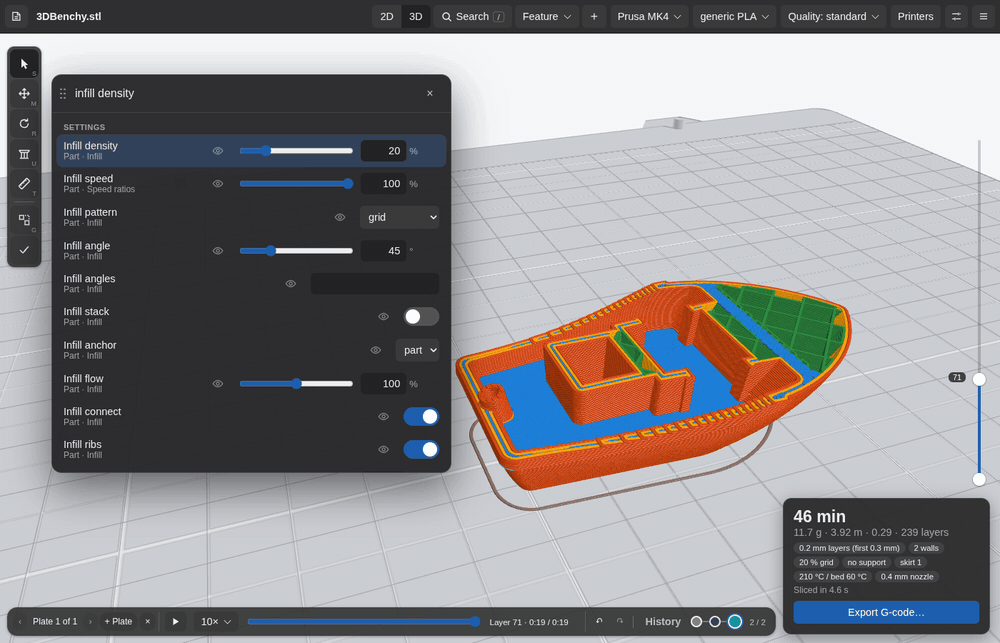
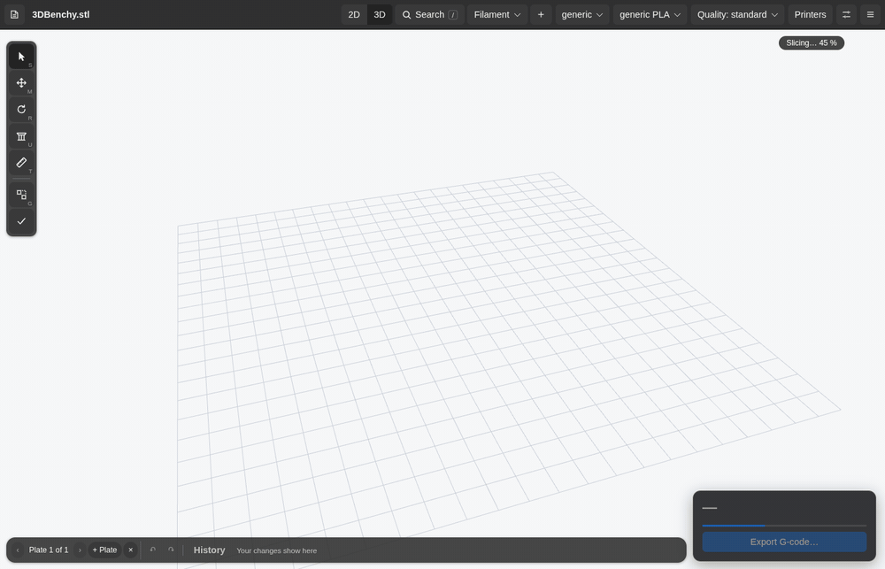
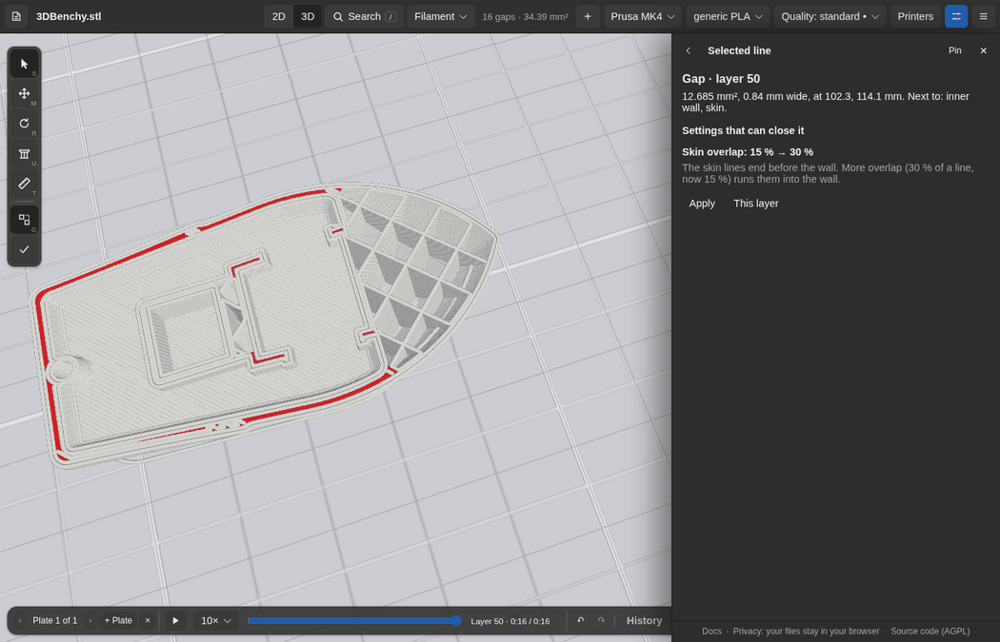
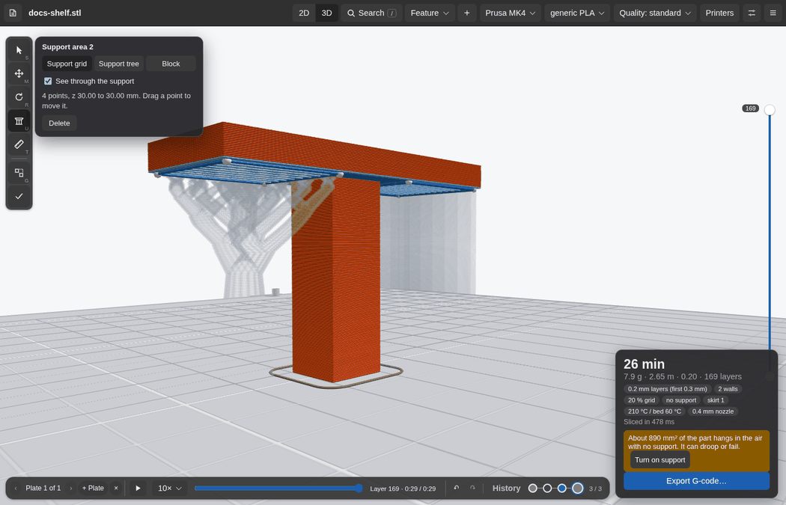
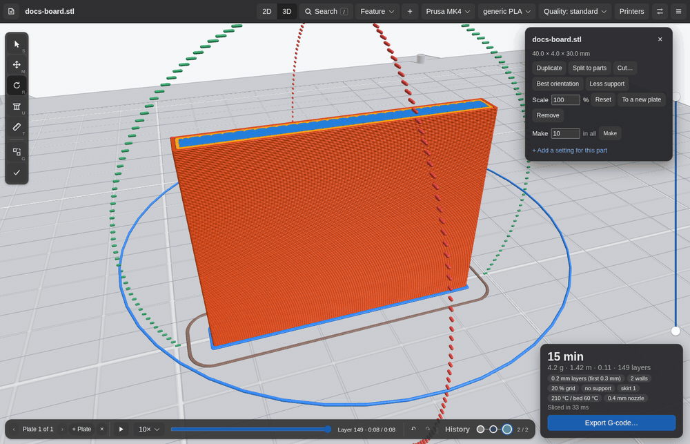
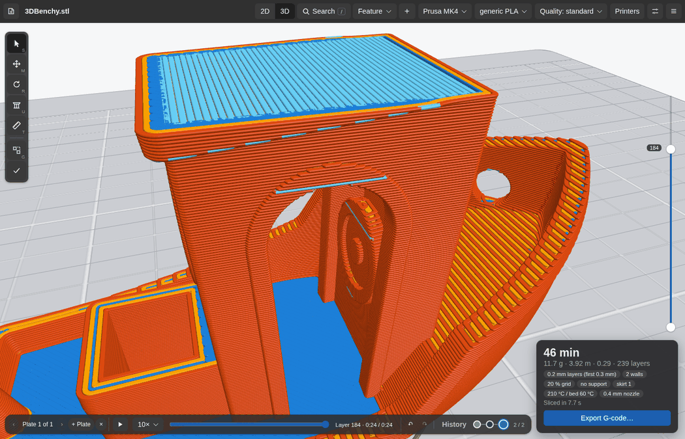
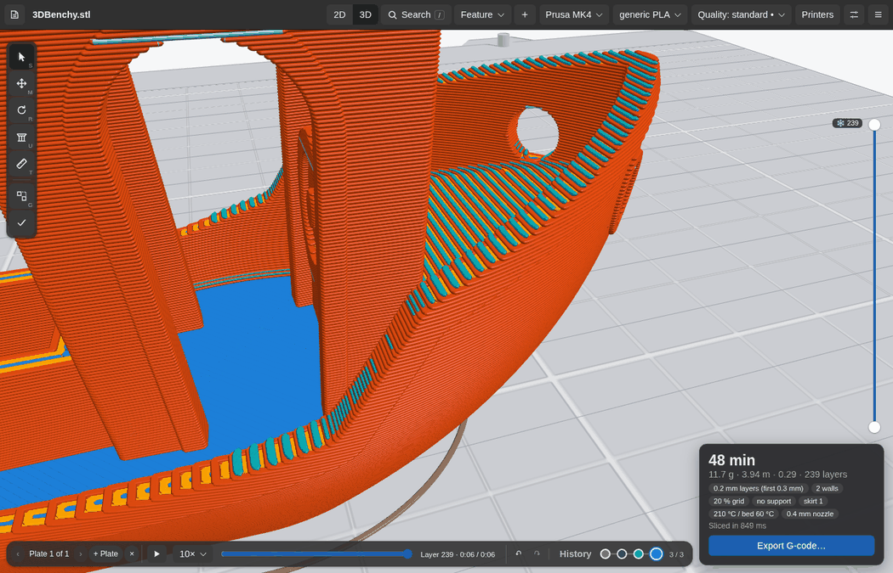
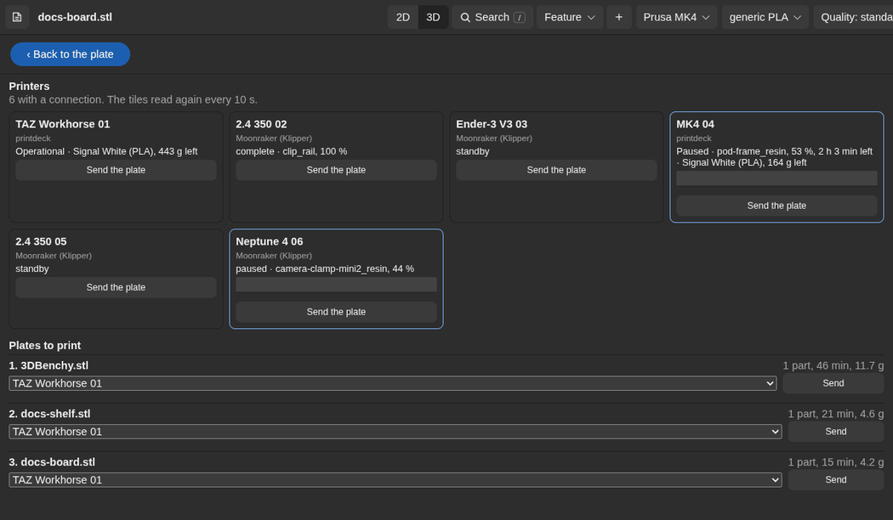
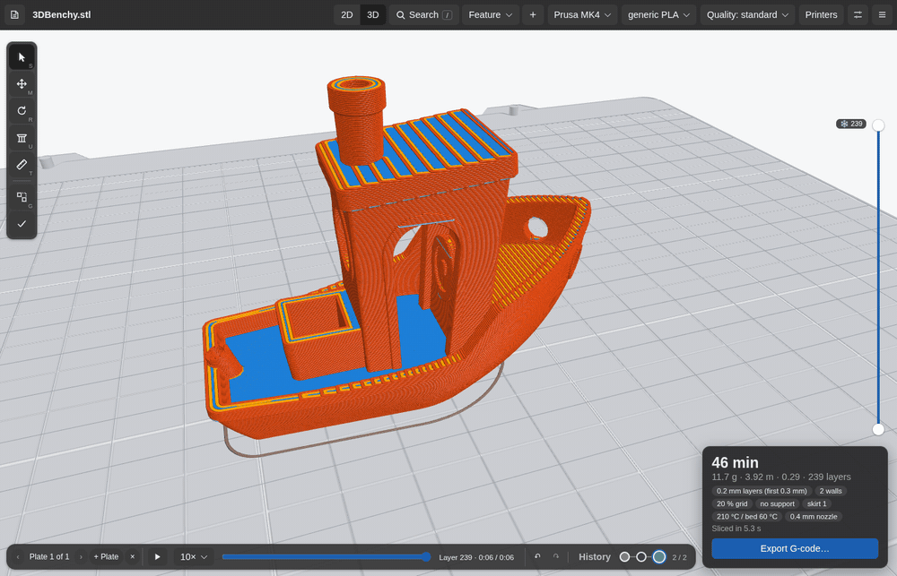

# zslice

A slicer for FDM 3D printers, written from scratch in Zig. Click any line of the preview to see what it is and why it prints the way it does. It slices fast enough to slice again while you drag a slider. And it runs in your browser: **[try it at zslice.beetlebug.org](https://zslice.beetlebug.org/)**, with no install.


## Highlights

Things that most slicers do not do.

### Click any line, see why

- Click a line in the 2D or 3D preview. A card opens next to the line: what the line is ("Outer wall · layer 227"), its planned speed, its real speed after acceleration, its flow, and the settings that matter for it.
- When the real speed is lower, the card says why. In the GIF, the chimney prints at 11 mm/s: the layer is short, so it slows down to cool.
- Change a setting on the card, and the part slices at once. **All settings…** opens the long form of the line in the settings panel.
- Press c to cut the view at the layer of the line. Press h, j, k, l to move the nozzle through the print, segment by segment, with the travel moves.
- Edit one line: leave it out of the print, or give it 10 % more or less plastic.
- Right-click a line for "Copy for AI" (a report of the line and its G-code) or "Add a drop of plastic here".

### Fast enough to slice while you drag



- A 3DBenchy (239 layers) slices in about 350 ms on a desktop CPU from 2015 with 4 cores.
- A change of a setting slices only what the change needs. A new infill density for the Benchy slices in about 60 ms.
- The 3D view stays at full speed while the part slices.

### Runs in your browser, on WebAssembly



- **[zslice.beetlebug.org](https://zslice.beetlebug.org/)** is the same Zig core, compiled to WebAssembly (1.2 MB compressed). The page has the same window as the desktop apps.
- The model slices on your computer, in a Web Worker. No file goes to a server.
- WebGL2 draws the same beads as the desktop apps.
- Open a model from a link: add `?model=` and the address of an STL file to the page address.
- It fits a phone. Pinch to zoom, and use one finger to orbit.


### Find the gaps, and get the settings that close them



- Turn on **Gaps** (G), and the view shows in red each area that should be solid and that no line covers.
- Click a gap. The panel says how big it is, what lines are next to it, and which settings can close it, each with the value to try and why.
- **Apply** changes the setting for the print, and **This layer** for that layer only. The gap list updates after the slice.
- Gap fill (on by default) closes most gaps: a line along the middle of each narrow area, with a width that follows the area. On the 3DBenchy, it fills 98 % of the gap area. The picture has gap fill off. With gap fill on, layer 50 has 4 gaps of 0.2 mm² in all.

### A check of the print before you print it


- **Check** lists what can make the print fail or print badly: overhangs with no support, bridges and their span, shapes that start in the air, lines over the flow of the hot end, layers too short to cool, and layers with many retractions.
- Each issue says what and why, in plain words, with the setting to change.
- Click an issue: the view goes to its layer and lights up its line.

### Hints on the print card


- With support off, the print card says how much of the part hangs in the air, with **Turn on support**.
- A file from CAD in inches loads 25.4 times too small. The print card asks if the file was in inches or in meters, with a button for each scale.
- A part off the bed gets a red warning, and an export or a send asks first.

### Draw the support where you want it



- The **Support** tool (U) draws an area on the part: click points around it, and click the first point to close it. Support grows under the area, also where the settings give none. A **Block** area keeps support out.
- Drag a point of an area, and the outline follows. The plate slices when you release it.
- **Tree support** plans its branches first. A branch gets wider on the way down, and never thinner, so it can stand. It prints hollow, as one wall loop.

### A part that cannot stand falls over



- Turn a part with the rings of the **Turn** tool (R), or with its keys. If the part cannot stand, it falls over onto a face, as a real part does on the bed.
- With support on, the support holds the part where you turned it.

### Bridges that print as bridges



- zslice finds each skin over air that solid plastic holds at its sides.
- The lines go across the air in the direction with the shortest longest span, of the directions where the lines start and end on solid plastic. They are anchored 1.5 mm into the plastic around the bridge, and joined there, so the nozzle never travels over the air.
- Bridges print slow, with the fan on full. The fan goes back after them.

### Smooth slopes, in the same layer



- A slope prints as a stair. **Slope smoothing** (experimental) goes back along the edge after each layer and lays one bead in each step, with its own height and flow at each point. The nozzle stays clear of the layer above.
- **Slope ironing** then irons the filled steps, from the top of the step down to its edge.
- Each point of these lines has its own Z, so the layer is not flat. All other lines stay planar.

### A page for all your printers



- **Printers** in the header shows each printer with a connection: its state, its job and the time left, and the filament in it.
- **Plates to print** lists each plate with its time and plastic, and the printers that fit it, the free ones first. A busy printer says when it is free.
- Each send asks first if the bed is clear.
- Each print that zslice exports or sends is signed. A [printdeck](https://github.com/beetlebugorg/printdeck) prints a file only from an app that it trusts.

### More

- **Layer profiles** (GTK and macOS apps). Right-click a line, then "New profile from here up" (or down): a copy of all settings for those layers. Any setting can change, the layer height too.
- **Copy for AI.** Right-click a line, then "Copy for AI": a report of the line, its settings, and its lines in the G-code file, to paste into a chat with an AI model.
- **Settings in the G-code.** The G-code ends with the settings that differ from the defaults, so you can compare a print with the settings that made it.
- **Tools and a measure tape.** Select, Move, Turn, Support, and Measure in the tool strip (S, M, R, U, T). The measure tape snaps to the ends of the lines. The long form of a line gives the length of a segment and of its edge, and the radius of a circle or an arc.
- **A history of changes.** The dock at the bottom has a mark for each change, and **History** lists each change in words ("Infill density 28 % → 45 % · Layers 86 and up"). Click a step to see the print at that step, or undo one change and keep the later ones. Orange marks on the layer slider show the layers with changes of their own.
- **h, j, k, l** step through the print segment by segment. The nozzle moves to each segment in the 3D view, with the travel moves, forward or back.
- **A sweep of all settings.** `zslice sweep part.stl` slices with values across the range of each setting, and lists the settings that change the time and the cost the most.
- **Printdeck.** With a [printdeck](https://github.com/beetlebugorg/printdeck) printer, the time includes the heat-up and the start (learned from its past prints), the filament settings follow the roll in the printer, the cost comes from the price of the roll, and the motion limits come from the printer.
- **Printer picker.** It opens on 15 popular printers. More than 1000 printers of more than 180 brands, from the printer definitions of Cura, PrusaSlicer, and OrcaSlicer: search as you type, a drawing of the build volume, and the key facts. The Linux and macOS apps find OctoPrint, printdeck, Moonraker, and PrusaLink printers on your network.
- **Start and end G-code.** The editor has the variables of zslice as buttons, and **Show the result** shows the G-code of the last slice with the values.
- **Cura profiles and projects.** Import a Cura profile stack, or open a Cura 3MF project with its per-object settings and its modifier meshes (an infill window, for example).


## Features

### Fast

- A 3DBenchy (239 layers) slices in about 350 ms, and the 3D view shows it at once.
- A change of a setting slices only what the change needs. On the Benchy, a new infill density slices in about 60 ms, and a new wall count in about 310 ms (`zslice bench`).
- The slicer uses all CPU cores but one. It keeps its work memory in arenas, so a slice uses little memory.
- A watchdog writes the stacks of all threads to a file if the window stops for 3 s. So we can find and fix a rare hang.

### Click a line, see why

- Click a line in the 2D or 3D preview. The line card shows what the line is (for example "Outer wall · layer 97"), its planned and real speed, its flow, and the settings that matter for it. **All settings…** opens the long form in the panel, with only the settings that change the line.
- Focus a field in the long form, and the panel explains what that setting does to the selected line, with its numbers: "50 % of 150 mm/s = 75 mm/s planned. It prints at 67 mm/s: the layer is short, and it slows to cool."
- The view shows all lines that the setting changes, and the selected line stays yellow.
- Use the arrow keys or h, j, k, l to go from segment to segment in print order, or to the nearest line on the layer above or below.

### Settings for one layer, or for a range of layers

- Each change in the long form of a line is for the whole part, for this layer, for this layer and up, or for this layer and down.
- For example: slower outer walls for the 10 layers of a thin tower, or a new skin direction for one layer.
- A changed layer shows a reset button. The changes go into the 3MF file of the plate.

### A settings panel that shows what each setting does


- The panel at the right has only the settings: sections, then settings, then the page of one setting, with one back arrow. Pin it beside the view, or let it slide over the view.
- Press `/` to search the settings and the actions. Each result has its slider or its switch, so you change a setting in the results.
- Select a setting, and the preview shows the lines that it changes. The other lines fade.
- Each feature in the help ("Outer wall", "Skin") is a link to all settings of those lines.
- Sliders with sensible ranges, units on all values, and speeds as a ratio of what the printer and the filament allow. A ratio shows the speed that it gives: "50 % = 75 mm/s".

### A preview that looks like the print



- The 3D view draws each line as a bead of the real width and height. Skin lines are pressed flat, and connected lines look connected.
- Color by filament, feature, speed, flow, layer time, or line width.
- A two-knob layer slider: the top knob is the top layer, and the bottom knob cuts away the layers below, so you can see inside a part at any height.
- Replay the print, or drag the scrub bar to move the nozzle through a layer.
- Seams, travel moves, and retractions show as marks.

### Slicing

- Walls: classic, or Arachne (walls that change their width to fill the space between them). A hidden seam goes into a corner that stays in place from layer to layer, or to the back where it is hard to see. Gap fill closes the narrow areas between walls and in the skin.
- Skin: lines, monotonic (each line lies against the line before it, for an even top surface), or concentric. Skin expand distance and skin removal width remove gaps and thin strips.
- Infill: lines, grid, triangles, trihexagon, cubic, gyroid, honeycomb, concentric, zigzag, flow, and lightning (branches only under the tops). A list of angles for each layer, infill that stacks the same on each layer (for a grille), and combined infill (one tall bead every N layers).
- Bridges: straight lines across the air, anchored at both ends, slow, with the fan on.
- Ironing.
- Support: grid or tree, with interface layers, and support areas that you draw. Tree support plans its branches, keeps them thick enough to stand, and reaches into deep, narrow holes.
- Combing: a travel inside the part goes around holes and does not retract.
- Cooling: a minimum layer time, by a slower print or by a cooling lap (the nozzle moves away while the fan blows on the part).

### Plate, files, and printers

- More than one plate, and more than one part on each plate: Ctrl+click selects a part, Ctrl+drag moves it, and Ctrl+wheel turns it. "Smart placement" turns each part for less support and packs the plate; a part can also be placed for less support only, or to be strong along an axis, and turned, scaled, or put down on a picked side.
- Shift+click adds lines to the selection: a change for "This layer" goes to the layers of all of them.
- STL and 3MF files. A 3MF save keeps the parts, their places, and their changes.
- Printers: OctoPrint, Moonraker (Klipper), Printdeck, USB serial (GTK app), and Bambu Lab in LAN mode (macOS app). Send a file, or send it and print. The Printdeck link reads the filaments of the printer. Each print has a signature line. Moonraker, USB, and Bambu Lab are not tested on real printers yet.
- Profiles for the machine, the filament, and the project, in TOML, with inheritance. A Cura profile can be imported.

### A library first

- One core in Zig, with a C API (`include/zslice.h`, `include/zslice-app.h`) and a WebAssembly build for the browser.
- The GTK4 app for Linux is a thin shell over the core. So are the macOS app (SwiftUI and Metal) and the web app: try it at <https://zslice.beetlebug.org/>, with no install.
- Each module explains its algorithm in its header comment. The code is also a book about how a slicer works.

## Documentation

The documentation site is at <https://zslice.beetlebug.org/docs.html>. The web app is at <https://zslice.beetlebug.org/>. [Privacy](PRIVACY.md): no analytics, no cookies, and your files stay in your browser.

- For people who slice: [Getting started](docs/user/getting-started.md) (the user guide), [The command line](docs/user/command-line.md), [Settings reference](docs/user/settings.md).
- For developers who use the library: [Embedding overview](docs/embedding/overview.md), with guides for Zig, C, and JavaScript.
- For developers who extend zslice: [How a slicer works](docs/internals/how-slicing-works.md), [Architecture](docs/internals/architecture.md), [Contributing](docs/internals/contributing.md).

All documents: [docs/README.md](docs/README.md). The status of each feature: [ROADMAP.md](ROADMAP.md).

## Build

zslice needs Zig 0.16. The Linux app also needs GTK 4, libsoup 3, json-glib, Meson, and a Vulkan driver.

```sh
zig build test                      # run the tests
zig build -Doptimize=ReleaseFast    # the command line tool: zig-out/bin/zslice
zig build lib -Doptimize=ReleaseFast  # libzslice.a, libzslice.so, zslice.h
zig build wasm                      # zig-out/web/zslice.wasm and zslice.mjs
```

The Linux app:

```sh
cd linux
meson setup build        # builds the core too (zig build lib)
ninja -C build
build/zslice-gtk part.stl
```

See [linux/README.md](linux/README.md) for the packages.

## Command line

```sh
zslice slice part.stl -m generic -f generic-petg -p fine -o part.gcode
zslice slice part.stl -o part.gcode -s project.wall_count=3 -s filament.nozzle_temp=220
zslice preview part.stl --layer 20 -o layer20.svg
zslice settings                     # all settings and their defaults
zslice profiles                     # the built-in profiles
zslice demo demo.stl                # write a test part
```

## Settings

The settings have three groups, with different owners:

- `machine.*`: facts about the printer. Examples: the bed size, the nozzle, and the speed limits.
- `filament.*`: facts about the material. Examples: the temperatures, and the maximum flow that the hot end can melt.
- `project.*`: what you want for this part. Examples: the layer height, the walls, and the infill.

Each group can come from a profile file (TOML), with inheritance (`extends`) and overrides. See [Profiles](docs/user/profiles.md).

A project does not set speeds in mm/s. It sets a ratio of the speed that the machine and the filament allow. One project then works on different printers and with different filaments.

## Embedding

Zig:

```zig
const zslice = @import("zslice");

var mesh = try zslice.Mesh.fromStl(gpa, stl_bytes);
defer mesh.deinit(gpa);
var settings: zslice.Settings = .{};
try settings.set("project.wall_count", "3");
const stats = try zslice.slice(gpa, &mesh, settings, writer);
```

C (`include/zslice.h`):

```c
zs_mesh *mesh;
zs_mesh_load_stl(bytes, len, &mesh);
zs_settings *settings;
zs_settings_new(&settings);
zs_settings_set(settings, "project.wall_count", "3");
zs_slice(mesh, settings, write_callback, user_data, &stats);
```

JavaScript (`web/zslice.mjs`):

```js
import { load } from "./zslice.mjs";
const zslice = await load(wasmBytes);
const { gcode, stats } = zslice.sliceStl(stlBytes, { "project.wall_count": 3 });
```

## License

AGPL-3.0-or-later. See `LICENSE`. The sources that zslice uses, and the licenses of the code in its binaries, are in `REFERENCES.md`.

The screenshots show a slice of [3DBenchy](https://www.3dbenchy.com/) by Creative Tools, licensed under CC BY-ND 4.0. The model is not in this repository.
