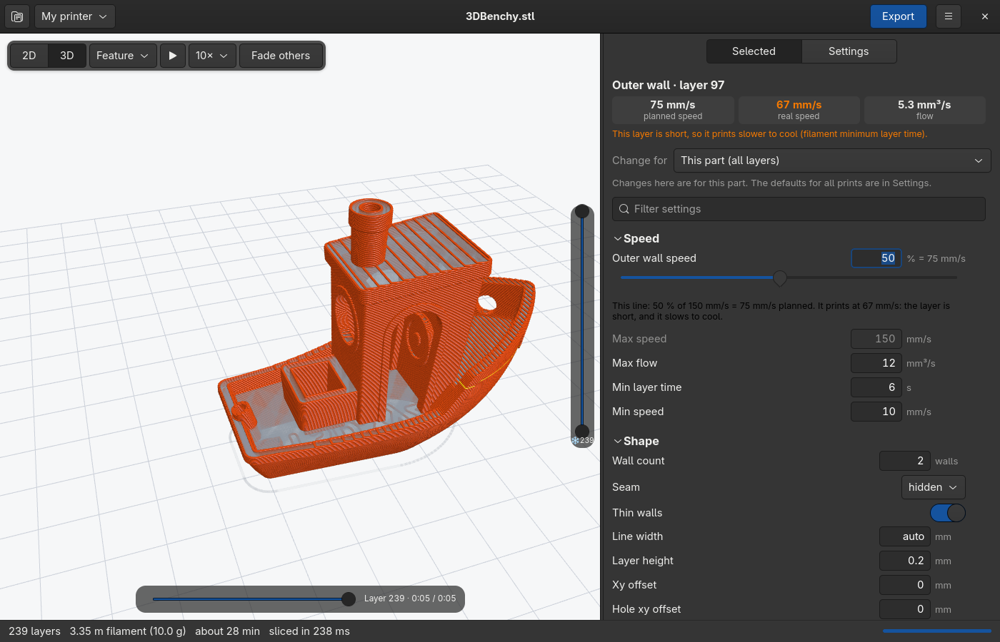

# zslice

A slicer for FDM 3D printers, written from scratch in Zig. It is fast enough to slice again while you drag a slider. Click any line of the preview to see what it is, and which settings change it.



## Features

### Fast

- A 3DBenchy (239 layers) slices in about 250 ms, and the 3D view shows it at once.
- A change of a setting slices only what the change needs. A new infill value takes about 20 ms on a 108-layer part; a new wall count takes about 120 ms.
- The slicer uses all CPU cores but one. It keeps its work memory in arenas, so a slice uses little memory.
- A watchdog writes the stacks of all threads to a file if the window stops for 3 s. So a rare hang can be found and fixed.

### Click a line, see why

- Click a line in the 2D or 3D preview. The panel shows what the line is (for example "Outer wall · layer 97"), its planned and real speed, its flow, and only the settings that change it.
- Focus a field, and the panel explains what that setting does to the selected line, with its numbers: "50 % of 150 mm/s = 75 mm/s planned. It prints at 67 mm/s: the layer is short, and it slows to cool."
- The view shows all lines that the setting changes, and the selected line stays yellow.
- Use the arrow keys or h, j, k, l to go from segment to segment in print order, or to the nearest line on the layer above or below.

### Settings for one layer, or for a range of layers

- Each change in the panel is for the whole part, for this layer, for this layer and up, or for this layer and down.
- For example: slower outer walls for the 10 layers of a thin tower, or a new skin direction for one layer.
- A changed layer shows a reset button. The changes go into the 3MF file of the plate.

### A settings browser that shows what each setting does


- Three columns: sections, settings, and help, as in a file manager column view.
- Select a setting, and the preview shows the lines that it changes. The other lines fade.
- Each feature in the help ("Outer wall", "Skin") is a link to all settings of those lines.
- Sliders with sensible ranges, units on all values, and speeds as a ratio of what the printer and the filament allow. A ratio shows the speed that it gives: "50 % = 75 mm/s".

### A preview that looks like the print

- The 3D view draws each line as a bead of the real width and height. Skin lines are pressed flat, and connected lines look connected.
- Color by filament, feature, speed, flow, layer time, or line width.
- A two-knob layer slider: the top knob is the top layer, and the bottom knob cuts away the layers below, so you can see inside a part at any height.
- Replay the print, or drag the scrub bar to move the nozzle through a layer.
- Seams, travel moves, and retractions show as marks.

### Slicing

- Walls, with thin walls and a hidden seam (the seam goes into a corner or to the back where it is hard to see).
- Skin: lines, monotonic (each line lies against the line before it, for an even top surface), or concentric. Skin expand distance and skin removal width remove gaps and thin strips.
- Infill: lines, grid, triangles, cubic, gyroid, honeycomb, concentric, zigzag, and flow.
- Ironing.
- Support: grid or tree, with interface layers. Tree support reaches into deep, narrow holes.
- Combing: a travel inside the part goes around holes and does not retract.
- Cooling: a minimum layer time, by a slower print or by a cooling lap (the nozzle moves away while the fan blows on the part).

### Plate, files, and printers

- More than one part on the plate: Shift+click selects a part, Shift+drag moves it, and Shift+wheel turns it. "Arrange the plate" packs the parts.
- STL and 3MF files. A 3MF save keeps the parts, their places, and their changes.
- Printers: OctoPrint, Moonraker (Klipper), Printdeck, and USB serial. Send a file, or send it and print. The Printdeck link reads the filaments of the printer. Moonraker and USB are not tested on real printers yet.
- Profiles for the machine, the filament, and the project, in TOML, with inheritance. A Cura profile can be imported.

### A library first

- One core in Zig, with a C API (`include/zslice.h`, `include/zslice-app.h`) and a WebAssembly build for the browser.
- The GTK4 app for Linux is a thin shell over the core.
- Each module explains its algorithm in its header comment. The code is also a book about how a slicer works.

## Documentation

The documentation site is at <https://beetlebug.org/zslice/>.

- For people who slice: [Getting started](docs/user/getting-started.md), [Settings reference](docs/user/settings.md).
- For developers who use the library: [Embedding overview](docs/embedding/overview.md), with guides for Zig, C, and JavaScript.
- For developers who extend zslice: [How a slicer works](docs/internals/how-slicing-works.md), [Architecture](docs/internals/architecture.md), [Contributing](docs/internals/contributing.md).

All documents: [docs/README.md](docs/README.md). The status of each feature: [ROADMAP.md](ROADMAP.md).

## Build

zslice needs Zig 0.16. The Linux app also needs GTK 4, libsoup 3, json-glib, Meson, and a Vulkan driver.

```sh
zig build test                      # run the tests
zig build -Doptimize=ReleaseFast    # the command line tool: zig-out/bin/zslice
zig build lib -Doptimize=ReleaseFast  # libzslice.a, libzslice.so, zslice.h
zig build wasm                      # zig-out/web/zslice.wasm and zslice.mjs
```

The Linux app:

```sh
cd linux
meson setup build        # builds the core too (zig build lib)
ninja -C build
build/zslice-gtk part.stl
```

See [linux/README.md](linux/README.md) for the packages.

## Command line

```sh
zslice slice part.stl -m generic -f generic-petg -p fine -o part.gcode
zslice slice part.stl -o part.gcode -s project.wall_count=3 -s filament.nozzle_temp=220
zslice preview part.stl --layer 20 -o layer20.svg
zslice settings                     # all settings and their defaults
zslice profiles                     # the built-in profiles
zslice demo demo.stl                # write a test part
```

## Settings

The settings have three groups, with different owners:

- `machine.*`: facts about the printer. Examples: the bed size, the nozzle, and the speed limits.
- `filament.*`: facts about the material. Examples: the temperatures, and the maximum flow that the hot end can melt.
- `project.*`: what you want for this part. Examples: the layer height, the walls, and the infill.

Each group can come from a profile file (TOML), with inheritance (`extends`) and overrides. See [Profiles](docs/user/profiles.md).

A project does not set speeds in mm/s. It sets a ratio of the speed that the machine and the filament allow. One project then works on different printers and with different filaments.

## Embedding

Zig:

```zig
const zslice = @import("zslice");

var mesh = try zslice.Mesh.fromStl(gpa, stl_bytes);
defer mesh.deinit(gpa);
var settings: zslice.Settings = .{};
try settings.set("project.wall_count", "3");
const stats = try zslice.slice(gpa, &mesh, settings, writer);
```

C (`include/zslice.h`):

```c
zs_mesh *mesh;
zs_mesh_load_stl(bytes, len, &mesh);
zs_settings *settings;
zs_settings_new(&settings);
zs_settings_set(settings, "project.wall_count", "3");
zs_slice(mesh, settings, write_callback, user_data, &stats);
```

JavaScript (`web/zslice.mjs`):

```js
import { load } from "./zslice.mjs";
const zslice = await load(wasmBytes);
const { gcode, stats } = zslice.sliceStl(stlBytes, { "project.wall_count": 3 });
```

## License

AGPL-3.0-or-later. See `LICENSE`. The sources that zslice uses, and the licenses of the code in its binaries, are in `REFERENCES.md`.

The screenshots show a slice of [3DBenchy](https://www.3dbenchy.com/) by Creative Tools, licensed under CC BY-ND 4.0. The model is not in this repository.
