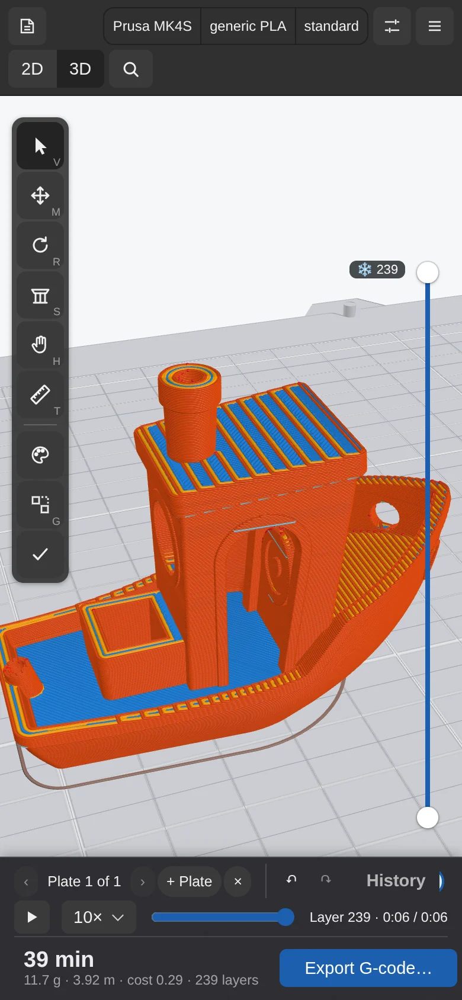

# Web, Linux, Mac, and Windows

The apps have the same window and the same tools. The pictures of this guide show the web app.



## The web app

[zslice.beetlebug.org](https://zslice.beetlebug.org/) runs the zslice core in WebAssembly. It needs WebGL2: Chrome, Firefox, or Safari of 2023 or later.

- **Your files stay in your browser.** The model slices on your computer. No file goes to a server. The page has no analytics and no cookies. See [Privacy](../../PRIVACY.md).
- **Your work stays after a reload.** The browser keeps the plates, your settings, and your printers.
- **Open a model from a link.** See [Open a model from a link](#open-a-model-from-a-link).
- **Printers.** The web app cannot search the network. Enter the address of the printer. The printer must allow requests from the page, for example a printdeck at its secure address.
- **On a phone**, the window fits the screen. One finger orbits, and two fingers pinch to zoom and pan.

## The Linux app

A GTK 4 app. Build it from the source tree:

```sh
cd linux
meson setup build        # builds the core too (zig build lib)
ninja -C build
build/zslice-gtk part.stl
```

See [linux/README.md](../../linux/README.md) for the packages. Where it differs from the web app:

- Alt+Left and the back button of the mouse go back to where you were before.
- It shows the active plate only.
- Preferences (Ctrl+,) has the printers, **Test the connection**, and **Get a key**. The API keys are in `~/.config/zslice/app.ini`.
- It has layer profiles, **Compare with Cura…**, USB printers, **Send all plates**, and **Export all plates…**.
- The part card of a painted part shows the filaments of its paint, with a button that opens the Paint tool.

## The macOS app

A SwiftUI app with a Metal view. See [The macOS app](macos.md): its keys, its settings pane, Bambu printers, the Keychain, and the farm queue.

## Open a model from a link

A model site can open a model in zslice with a link of the form `zslice://open?file=` and the address of the file. This is the form of the "Open in slicer" links of model sites, for example `prusaslicer://open?file=` on Printables.

Each app does the same steps:

1. It shows the file name and the site, and asks **Open this model?**. Press **Download and open** to go on. Enter does not download.
2. It downloads the file. It takes only https addresses of public sites, up to 512 MB.
3. It opens the file on a new plate if the current plate has parts.

A link opens only STL, 3MF, STEP, and OBJ files. It never opens a zslice project, and it never starts a print. A link to a device on your network (an IP address, a `.local` name, or a name that leads to a local address) does not open.

- **Linux.** The app registers the `zslice://` links and the model file types when it is installed (the `.desktop` file). A link goes to the open window.
- **Windows.** The app registers the links and the model file types for your user. See [The Windows app](windows.md).
- **macOS.** The app registers the `zslice://` links.
- **The web app.** A web page cannot take a `zslice://` link. In the web app, open the **Open** menu and press **Open links from model sites here**. Your browser then sends `web+zslice://` links to the page. A site can also link to the web app with `https://zslice.beetlebug.org/?open=` and the address of the file. The site must allow other pages to read its files (CORS). If it does not, the dialog says so and offers **Download the file**. Then drop the file on the window.

## Import a model from a model page

A model on Printables or Thingiverse often has many files. zslice lists them, and you choose the files to load.

1. Open the search (`/`) and choose **Import from a model page**, or open the menu of the plate. In the web app, open the **Open** menu.
2. Paste the address of the model page, for example `https://www.printables.com/model/3161-3d-benchy`.
3. zslice lists the files of the model in groups: 3MF, STL, STEP, OBJ, and the other files (which zslice does not load). It checks the files to load first. A STEP file of a part with an STL file is not checked. When the model has 3MF files and STL files, only the STL files are checked, because they often hold the same parts.
4. Check and uncheck the files, then press **Download and load**.
5. zslice downloads the files and puts their parts on a new plate. The parts that do not fit go on more plates. It never starts a print.

You can also open the ZIP file of a model ("Download all" on the site) with **Open**, or drop it on the window. zslice then lists its files in the same way.

- **Printables.** The Linux app reads the list of files from Printables, with a picture of each file.
- **Thingiverse.** Thingiverse lets only registered apps read its lists. zslice opens the page in your browser. Download all the files as a ZIP file there, then open the ZIP file in zslice.
- **The web app.** The browser does not let a page read the lists of Printables or Thingiverse. The web app opens the page. Download the ZIP file there, then drop it on the window.

## The command line

To slice with no window, see [The command line](command-line.md).
