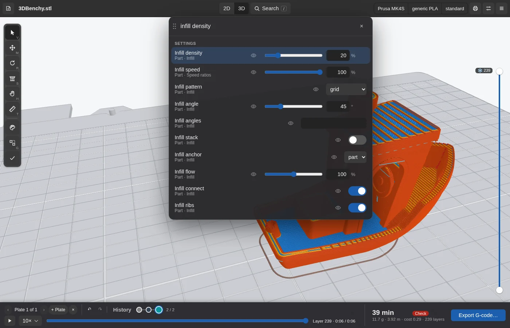
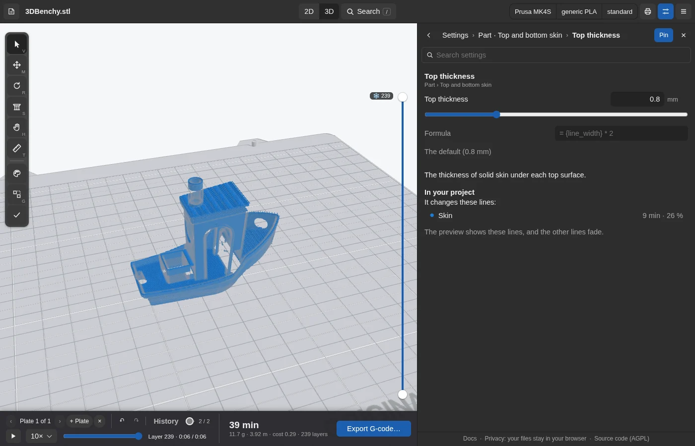

# Change a setting

Press `/`, type a few letters, and drag the slider. The print slices again while you drag.

## Search with /

1. Press `/`, or click **Search** in the header.
2. Type a few letters, for example `infill`, `brim`, or `export`. Other names also work: `perimeters` finds the walls, and `temp` the temperatures.
3. Change the value in the result. The part slices again at once.

- Click the eye of a setting (or press V) to show only the lines that it changes.
- An action (Export G-code, Arrange the plate, Undo, and others) runs with a click or Enter.
- The search does not block the view. Turn the view and click lines while it is open.
- Keys: ↑ and ↓ go through the results. ← and → change the value. Esc closes the search.

## The settings panel

1. Press N, or click the panel button in the header.
2. Click a section, then a setting. The › at the end of a row opens the page of the setting.
3. Click **Pin** to put the panel beside the view. Drag the splitter to change its width.

The sections come in the order of use. The part starts with the layers, the walls, the skin, the infill, the support, the skirt and brim, and the speed. The filament starts with the temperatures and the cooling. In each section, the settings that most people change come first, and the expert settings come last. The search (`/`) finds each setting.

The page of a setting gives its value, its default (with **Reset**), what it does, and the lines that it changes. While a setting is open, the view shows only its lines. The other lines become ghosts.

To change a number:

- type it, and press Enter;
- press ↑ or ↓ (Shift: 10 steps, Ctrl: a tenth of a step);
- drag the name of the setting to the left or the right;
- drag its slider.

A speed is a ratio of what the printer and the filament allow: "50 % = 75 mm/s". So one quality works on each printer.

## Where a value comes from

A higher level replaces the value of a lower one. A small tag under the name of a setting gives its level.

| Level | Where you set it |
|---|---|
| Default | Built in. |
| Global | Your settings for all prints. |
| Printer | The printer menu. |
| Filament | The filament menu, or the roll in the printer. |
| Quality | The quality menu: fine (0.1 mm), standard (0.2 mm), draft (0.3 mm), coarse (0.4 mm), or your own. |
| This print | Your changes for this plate. |
| This part | The changes of one part. |

The filament and the quality menus have **Save as profile…**. See [Profiles](profiles.md) for the files.

**Tip:** A part can have settings of its own: click **+ Add a setting for this part** on its card. A setting can also change for some layers, or follow a formula. See [Formulas and rules](expert.md).

## Where to go next

- → [Place the parts](parts.md): move, turn, scale, and cut.
- → [Settings](settings.md): each setting, its unit, and its default.
- → [Formulas and rules](expert.md): settings for some layers, formulas, and path rules.
