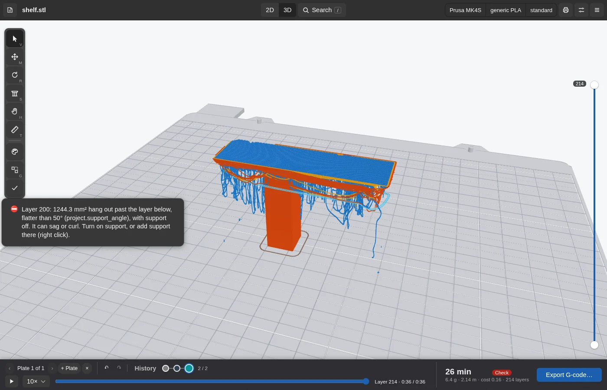
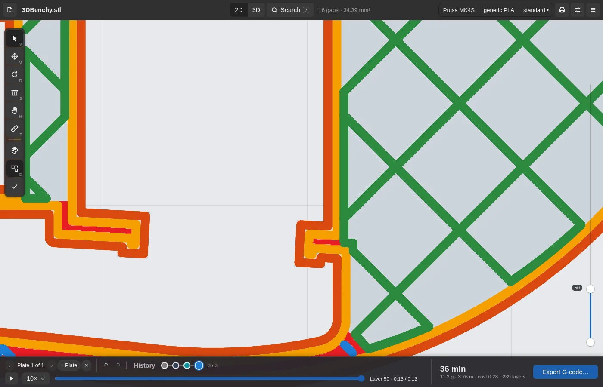
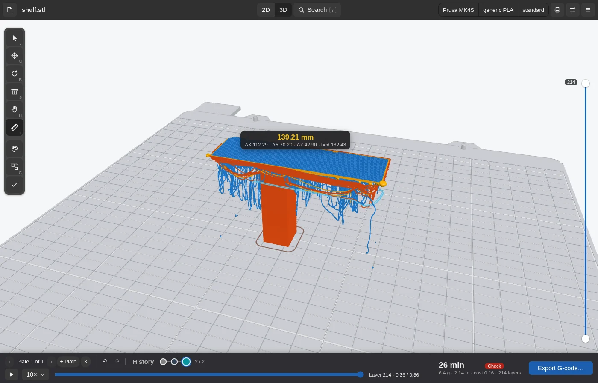

# Check the print

Find the problems before you print: overhangs with no support, gaps in the solid layers, and wrong sizes.

## Check

Click **Check**, the last button of the tool strip. A count on the button gives the number of problems. The print card gives the same count: "3 to check". The list gives, the worst first:

- an overhang with support off;
- a bridge, with its span (a long bridge can sag);
- a shape that starts in the air;
- a line that needs more plastic than the hot end melts (`filament.max_flow`);
- layers that print faster than `filament.min_layer_time`;
- a layer with many retractions;
- with one part at a time (`project.print_sequence = by_object`), two parts closer than the print head, and a part higher than the gantry that does not print last (see [One part at a time](plates.md#one-part-at-a-time)).

Each issue says what it is, and which setting changes it. Click an issue: the view goes to its layer, and selects its line.

## Gaps

1. Click **Gaps** in the tool strip. Gaps has no key. The gaps of the top layer show in red. The header gives their count and their area.
2. Click a gap. The panel gives its size and the settings that can close it, the best first.
3. Click **Apply** for the whole print, or **This layer** for the layer of the gap.

Gap fill (on by default) closes most gaps.

## Measure

Press T. Click two points of the print or the bed.

- The label gives the distance, and its parts along X, Y, and Z.
- A point near the end of a line snaps to it. Hold Shift for no snap.
- A click on a circle or an arc gives its diameter, and puts the point at its center.
- Esc clears the tape.

## Where to go next

- → [Add support](support.md): fix the overhangs.
- → [The print as it forms](print-as-it-forms.md): see a bridge sag before you print it.
- → [Send to a printer](printers.md): print it.
