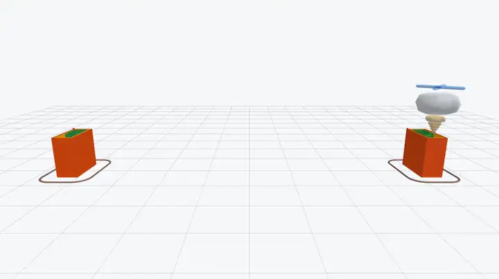
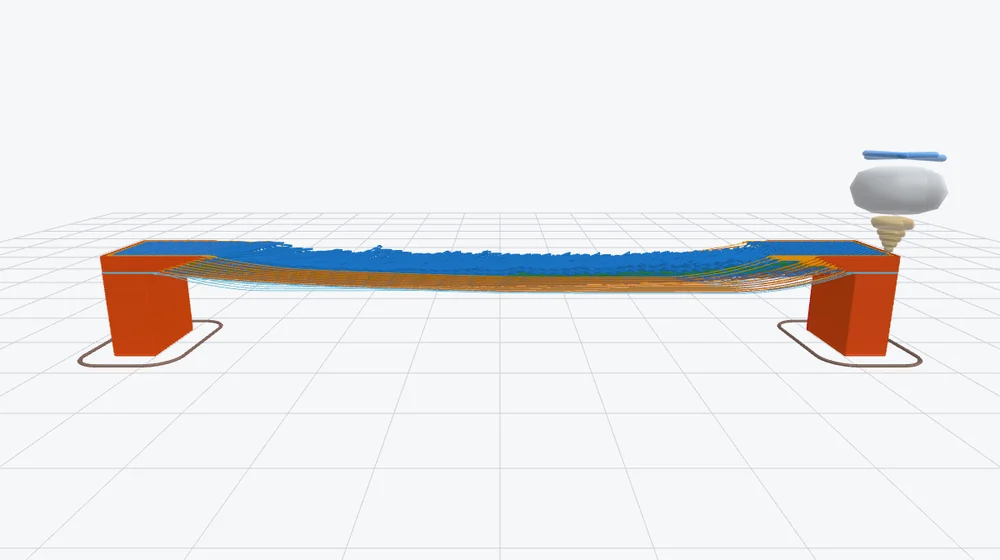
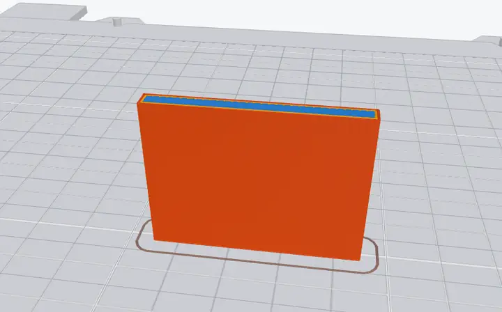
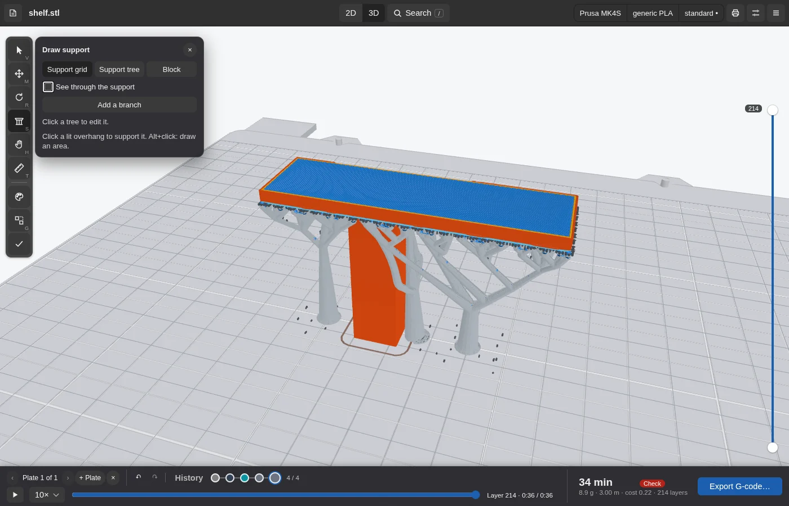
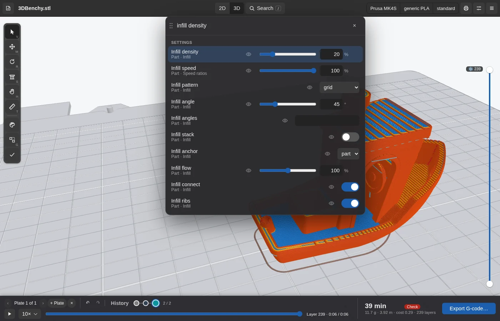
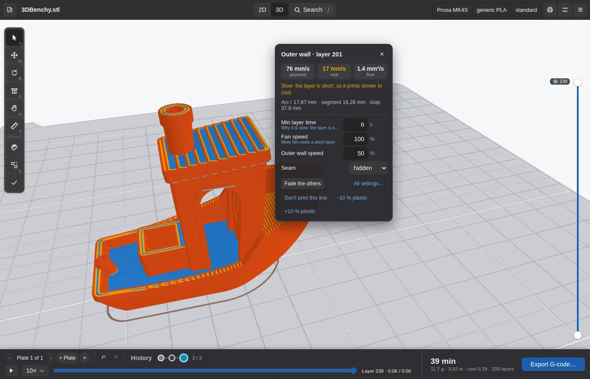
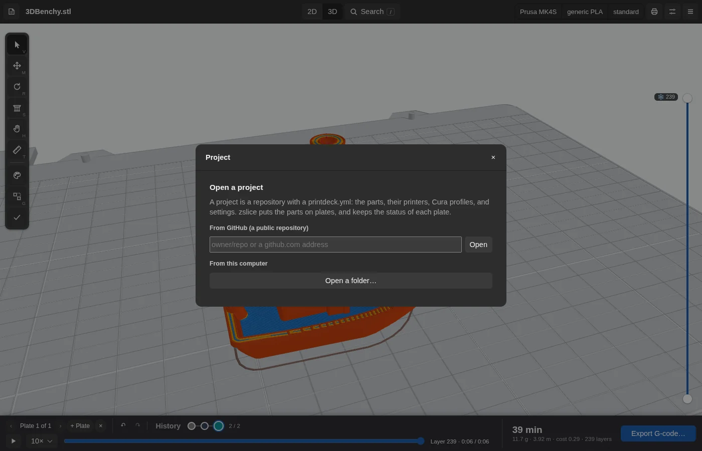
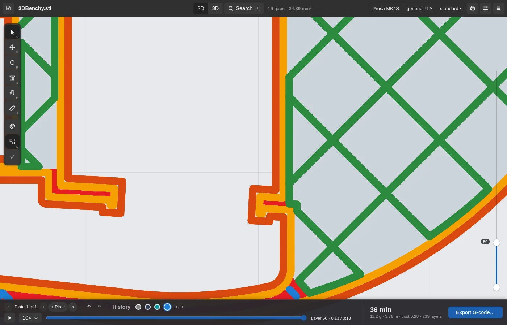
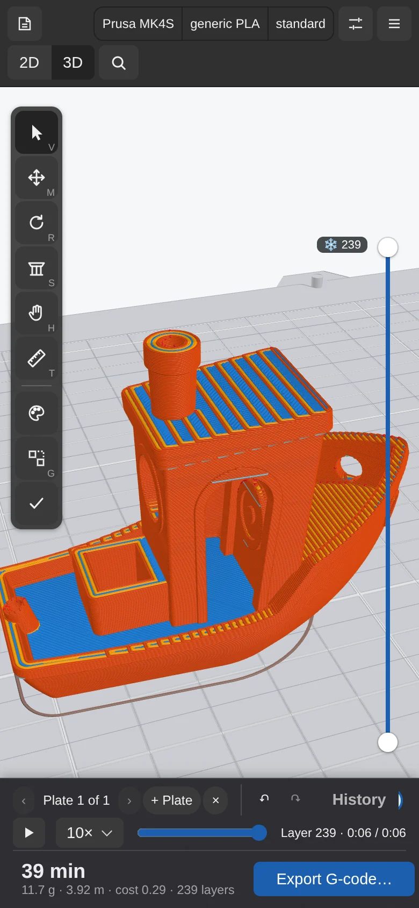
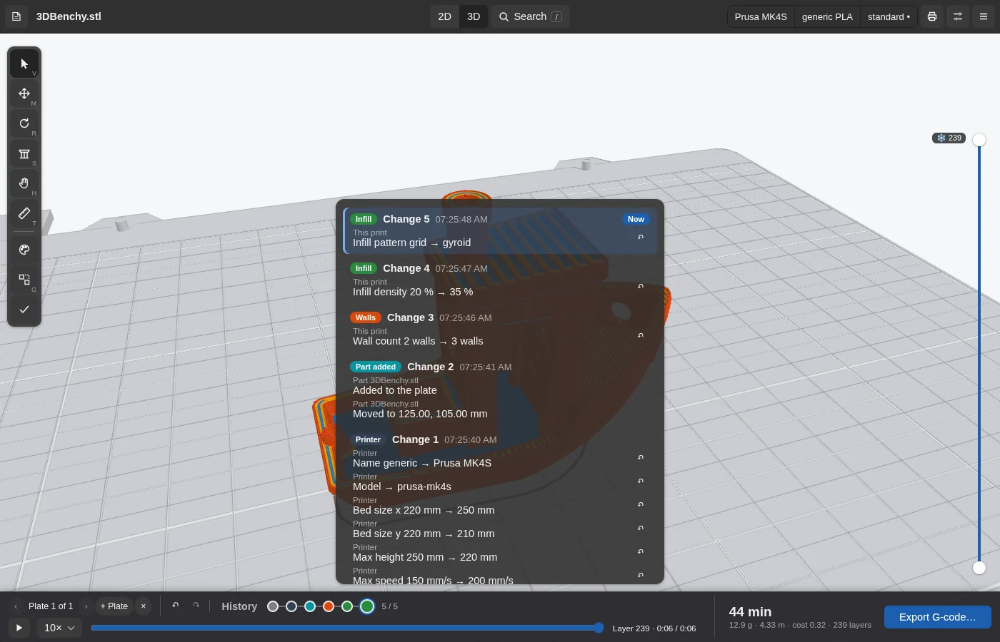

# The best features

zslice shows the print as the plastic forms it, and the parts obey physics. Pick a feature, and go to its page.

## See the print before you print it

-  **The print as it forms.** zslice simulates the plastic as it leaves the nozzle. It cools with the fan, and it sags or falls where no plastic holds it. A bridge sags, and a slab over the air falls in strands. [Go to the page.](print-as-it-forms.md)
-  **Parts with real physics.** A part that cannot stand falls over onto a face, as on a real bed. The Grab tool picks a part up. Let go, and it rests flat. [Go to the page.](parts.md#a-part-falls-over)
-  **A support editor.** Click an overhang to put support under it. Drag the dots of tree support to move the branches. zslice keeps each branch within the rules. [Go to the page.](support.md)
-  **Edits at full speed.** Drag a slider, and the print slices again while you drag. A change slices only what it needs: a new infill density for a Benchy slices in about 60 ms. The view stays at full speed. [Go to the page.](change-settings.md)
-  **Click a line, see why.** Each line tells what it is, its real speed, and the reason when it is slow. Change a setting on the card. [Go to the page.](lines.md)
-  **printdeck projects.** Open a repository of parts from GitHub. zslice puts the parts on plates, with their printer, profile, and material. [Go to the page.](projects.md)

## More

-  **Gaps and checks.** See each area that no line covers, and the settings that close it. **Check** lists what can make the print fail. [Go to the page.](check.md)
-  **In your browser.** The same core runs in WebAssembly at [zslice.beetlebug.org](https://zslice.beetlebug.org/). Your files stay on your computer. [Go to the page.](apps.md)
-  **A history in words.** Each change has a mark on the dock. Go back to any change, or undo one setting and keep the later changes. [Go to the page.](history.md)

## Where to go next

- → [The print as it forms](print-as-it-forms.md): the plastic, layer by layer.
- → [printdeck projects](projects.md): a repository of parts to print.
- → [A print farm](farm.md): all your printers on one page.
