# Getting started

This guide explains the zslice apps: the web app, the Linux app (GTK), and the macOS app. The three apps have the same window and the same tools. The pictures show the web app. [The macOS app](macos.md) lists where the Mac app differs. To slice with no window, see [The command line](command-line.md).

1. [Your first print](#your-first-print)
2. [The window](#the-window)
3. [Look at the print](#look-at-the-print)
4. [Parts](#parts)
5. [Settings](#settings)
6. [Support](#support)
7. [Measure and check](#measure-and-check)
8. [Plates and projects](#plates-and-projects)
9. [Printers](#printers)
10. [Print farm](#print-farm)
11. [History and undo](#history-and-undo)
12. [Keyboard](#keyboard)
13. [For each platform](#for-each-platform)

## Your first print

Do these steps for your first print. You need only this section.

1. **Open zslice.** Go to [zslice.beetlebug.org](https://zslice.beetlebug.org/) in a web browser. You do not install the web app. To build the Linux or the macOS app, see [For each platform](#for-each-platform).
2. **Choose your printer.** At the first start, the printer picker opens on the popular printers. Click your printer, then click **Next** and **Add printer**. If your printer is not in the list, type a part of its name in the search, for example "ender 3" or "k1 max".
3. **Open a model.** Drop an STL or 3MF file on the view, or click **Open…**. zslice slices the model at once.
4. **Choose the material and the quality.** Use the **Filament** menu (for example "generic PLA") and the **Quality** menu (for example "standard", 0.2 mm layers) in the header.
5. **Look at the preview.** Drag in the view to turn it, and turn the mouse wheel to zoom. The print card at the bottom right gives the print time and the plastic.
6. **Export or send.** Click **Export G-code…** on the print card, and copy the file to your printer. With a printer connection, the button is **Print**. It sends the file to the printer.

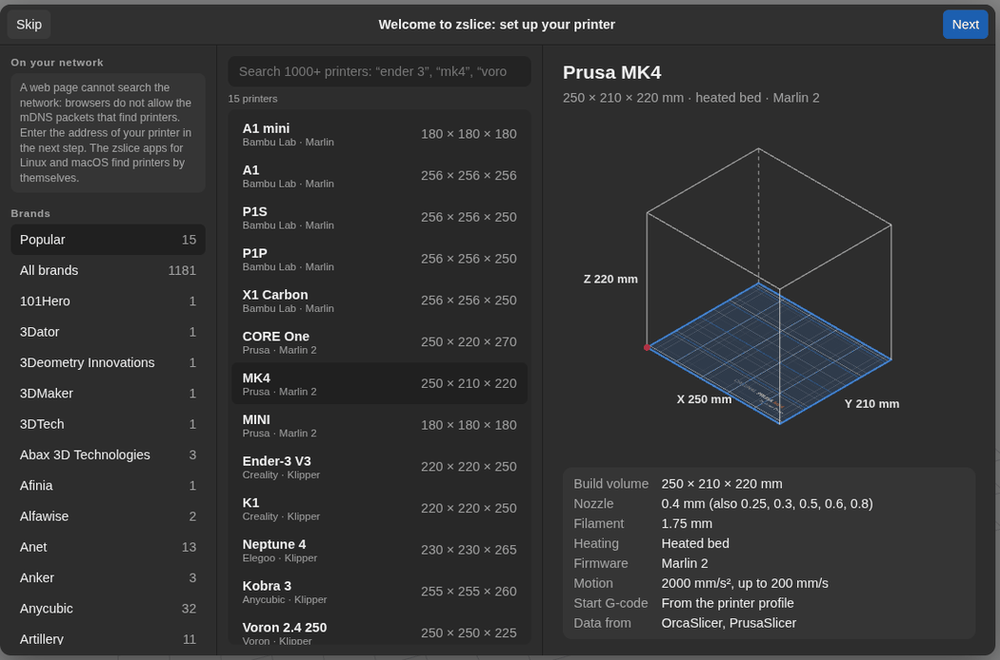

The print card can show a note in a colored box. Read it before you print:

- "About 890 mm² of the part hangs in the air with no support": click **Turn on support**.
- "part.stl is only 2.36 mm. Was the file in inches or in meters?": click **Inches (×25.4)** or **Meters (×1000)**.
- "A part is off the bed or on another part" (red): move, turn, scale, or cut the part.

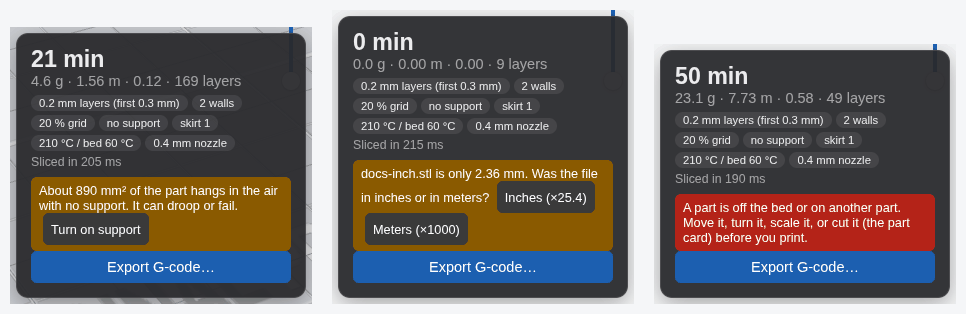

## The window

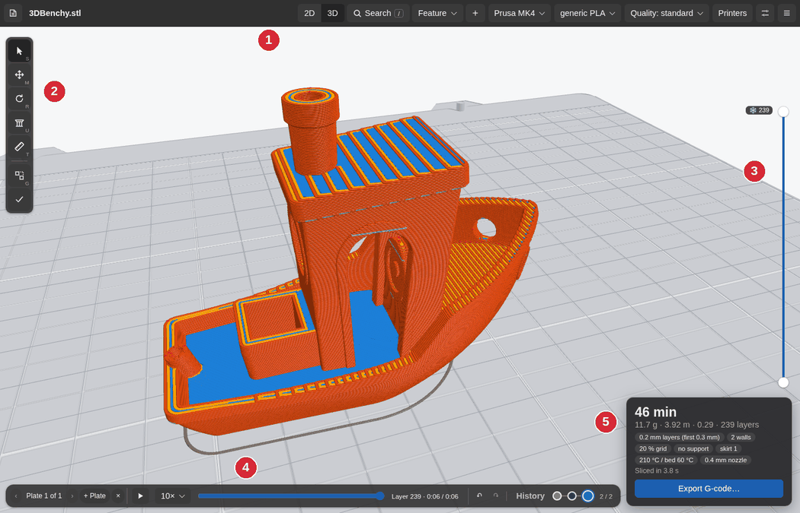

The view fills the window. The header is at the top, and four things float over the view:

1. **The header.** At the left: Open and the name of the file. In the middle: 2D and 3D, **Search** (`/`), the colors of the lines, and **+** (add models to this plate). At the right: the printer, the filament, and the quality menus, **Printers** (the Printers page), the settings panel (N), and the main menu.
2. **The tool strip** (at the left): Select (S), Move (M), Turn (R), Support (U), Measure (T), then Gaps (G) and Check. The key of each tool is in the corner of its button.
3. **The layer slider** (at the right): the top knob is the top layer that shows, and the bottom knob cuts away the layers below it.
4. **The dock** (at the bottom) has three groups. The plates: ‹ › "Plate 1 of 1", All, + Plate, and ×. The replay: ▶, its speed, and the scrub bar. The history: ↶ ↷, **History**, and a mark for each change.
5. **The print card** (at the bottom right): the print time, the plastic, the cost, the layers, the main settings of the print, and **Export G-code…** or **Print**. It hides on an empty plate.

The settings panel is at the right. It has only the settings. Press N, or click the panel button in the header, to show it or hide it. It slides over the view. Click **Pin** to put it beside the view as a column. Drag the splitter to change its width. The app keeps your choice for the next start.

The history is a popover over the dock. The project is a dialog: **Open a project…** in the main menu. The Printers page covers the view: **Printers** in the header. **‹ Back to the plate** closes it.

In a narrow window, the dock fills the width, and the print card sits over it. For a phone, see [For each platform](#for-each-platform).

## Look at the print

### Move the view

| Mouse or touch | Action |
|---|---|
| Left drag | Orbit: turn and tilt around the part. The bed stays level. |
| Middle or right drag | Pan: move the view. |
| Mouse wheel | Zoom toward the pointer. |
| Two fingers pressed down on a touchpad, and a drag | Pan. |
| A light two-finger swipe, or a pinch on a touchpad | Zoom toward the pointer. |
| One finger on a touch screen | Orbit. |
| Two fingers on a touch screen | Pinch to zoom about the point between them. A move of that point pans. |
| Double-click on a side of a part | The view turns to face that side, and zooms to it. |
| Double-click elsewhere | Reset the view. |

**2D** in the header shows the top layer from above, as a drawing. **3D** shows the print as beads of the real width and height. Skin lines are pressed flat, and connected lines look connected.

The colors menu in the header colors the lines by filament, feature, speed, flow, layer time, or line width. With speed, flow, layer time, or line width, a legend gives the range. In the feature colors, the outer wall is orange, the inner walls are yellow, the skin is blue, the infill is green, bridges are sky blue, and support is gray. Seams, travel moves, and retractions show as marks.

### The layers

Drag the top knob of the layer slider to see the print up to a layer. Drag the bottom knob to cut away the layers below, and see inside the part at any height. Orange marks at the right of the slider show the layers with changes of their own.

Click in the view first, so that it gets the keys:

| Key | With a selected line | With no selection |
|---|---|---|
| ← or h | The segment before it, in print order (Shift: the line before) | The nozzle back 2 % of the layer |
| → or l | The segment after it, in print order (Shift: the line after) | The nozzle on 2 % of the layer |
| ↑ or k | The nearest line on the layer above | The top layer up one |
| ↓ or j | The nearest line on the layer below | The top layer down one |
| Page Up, Page Down | 10 layers up or down | 10 layers up or down |
| C | Show the layers up to the line | — |
| Shift+C | Show all layers | Show all layers |
| Esc | Clear the selection | — |

Shift with ↑ or ↓ (or k or j) moves the bottom knob of the layer slider.

### Replay the print

Press ▶ on the dock. The 3D view shows the print as it grows, line by line, at the speed in the menu next to it (1× is the real speed). The scrub bar moves the nozzle through the top layer: at the left end the layer starts, and at the right end it is done. The label gives the time in the layer. A drag of the bar pauses the replay. A nozzle in the 3D view shows where the print is.

### Click a line

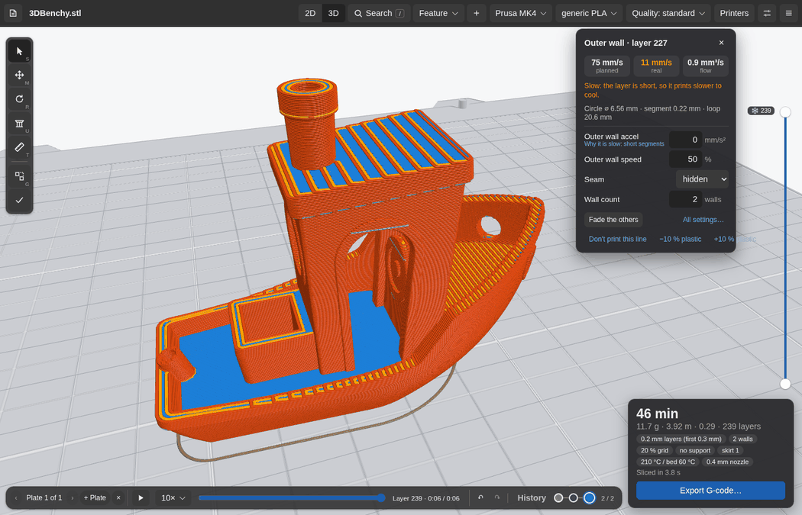

Click a line in the 2D or 3D view. The line becomes yellow, and the segment under the pointer orange. A card opens next to the line:

- the feature and the layer, for example "Outer wall · layer 228";
- the planned speed, the real speed, and the flow;
- why the line is slow, in plain words, for example "the layer is short, so it prints slower to cool";
- its size: the length of the segment and of the loop, and the diameter of a circle;
- the settings that matter for this line, each with its editor. The card picks them from the line. First the setting that makes it slow, then the first layer settings on the first layer, then a setting that you changed. The main settings of its feature come last. A note under a setting says why it is there.

Change a setting in the card, and the part slices at once. **Fade the others** shows the line solid and the other lines as faint ghosts. **All settings…** opens the long form of the line in the panel, with one back arrow to the settings. Drag the top row of the card to move it. Esc, ×, or a click on no line closes the card.

The long form has the planned speed, the real speed, and the flow, and then the settings that change the line in three groups: Speed, Shape, and Material. "How these values come about" explains each number. It also gives the measurements of the segment: its length, the length of its straight edge, and the length of the whole line. For a circle or an arc, it gives the radius. They follow the segment as h and l move it.

Shift+click adds a line to the selection, or removes it from the selection. With more than one line, a change for "This layer" goes to the layers of all of them.

### Edit one line

The line card has three edits for the selected line:

- **Don't print this line** (or Delete): the line stays out of the print.
- **−10 % plastic** and **+10 % plastic**: less or more plastic for the line.

**Add a drop of plastic here** in the menu of the view puts a dot of 1 mm of plastic at that point, on the top layer. Use it to fill a small gap. Each edit is one step of the history, so Ctrl+Z undoes it. The project file keeps the edits, and the History popover lists them.

### The menu of the view

Right-click a line in the 3D view (or press Shift+F10 with a line selected):

- **Preview to this layer** (C): the layer slider goes to the layer of the line.
- **Show all layers** (Shift+C), when the slider hides some layers.
- **Add support here** › Grid, Tree, or Bridge (a pad), **Block support here**, **Remove the support marks here**, and **Clear all support marks**. See [Support](#support).
- **Copy for AI**: copies a report of the line to the clipboard. Paste it into an AI chat, and ask why the line prints as it does. The report has what the line is, its numbers and why, the settings that change it, the printer and the filament, its points, and its place in the G-code.
- **Add a drop of plastic here**.
- **New profile from here up** (or **from here down**), in the GTK and macOS apps. See [Settings for some layers](#settings-for-some-layers).
- **Put this side on the bed**, and **Placement**. See [Parts](#parts).
- **Test print: the top layer…** saves the G-code of the top layer alone, on the bed. With the slider cut to some layers, **Test print: the layers shown…** saves those layers, lowered to the bed. Compare the test print with the 3D view.
- **Reset the view**.

## Parts

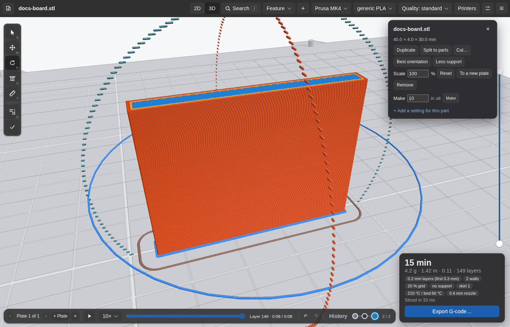

### Select a part

With the Move tool (M) or the Turn tool (R), click a part. With another tool, hold Ctrl and click. A card opens next to the part:

- its name and its size;
- **Duplicate** (D): a copy at a free place on the bed, with the settings of the part;
- **Split to parts**: each separate body of the part becomes a part of its own;
- **Cut…**: cut the part in two with a level plane;
- **Best orientation** and **Less support**: turn the part;
- **Scale** in %, **Reset** (the orientation and the scale of the file), and **To a new plate**;
- **Remove** (Delete);
- **Make [10] in all**: copies of the part, until there are that many;
- the settings of this part, and **+ Add a setting for this part**.

Tab and Shift+Tab select the next part and the part before. Esc clears the selection. Drag the top row of the card to move it.

### Move and turn

- **Move.** Drag the part with the Move tool, or hold Ctrl and drag with another tool. The arrow keys move the selected part 1 mm (with Shift, 10 mm).
- **Turn on the bed.** Turn the mouse wheel over the part with the Move tool, or hold Ctrl and turn the wheel with another tool: 15° for each step. `[` and `]` also turn it 15° (with Shift, 1°).
- **Turn about any axis.** With the Turn tool, three rings go around the part. Drag the red ring to turn the part about X, the green ring about Y, and the blue ring about Z, in steps of 15° (Shift: 5°). Keys: Left and Right turn it about Z, Up and Down about X, Page Up and Page Down about Y.

In the web app, a turn slices once, when you release the ring, or after a pause of 0.6 s in the keys. In the GTK app, each step slices at once.

### A part falls over

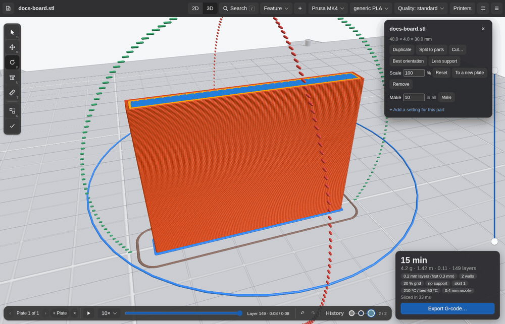

After a turn, zslice checks if the part can stand. If its center of mass is past its foot, the part rolls over the edge until it rests on a face. It stays at its place on the bed. A note says how far it fell. With support on, the support holds the part, and it stays as you turned it.

### Placement

The menu of the view (right-click a part) has **Placement**:

- **Smart placement**: turn the part for the least support, the most area on the bed, and a low height. Right-click the empty view for **Smart placement** of all parts, and for **Arrange the plate**.
- **Less support**: the orientation with the least support only.
- **Strong along** X, Y, or Z of the part: say which way the load goes. A print is weakest across its layers. So the part turns until that axis lies in the layers, and then gets the least support.
- **Put this side on the bed**: the side of the part at the click goes down.

### Scale

Type the scale in % on the part card. A file from CAD in inches loads 25.4 times too small. When the largest side of a part is under 3 mm, the print card asks if the file was in inches or in meters, with a button for each scale. A part that grows past the bed after a scale goes to a free place.

### Cut a part

Cut a part that is too tall or too big for the bed, or a part that prints better in two pieces:

1. Select the part, and click **Cut…** on its card.
2. Set the height of the cut with the slider or the number. An orange plane shows the cut in the view.
3. Keep **Turn the top over** on, so the top prints on its flat cut face.
4. Keep **Pegs to line up the parts** on, and choose the count and the diameter (2 pegs of 5 mm at first).
5. Click **Cut**.

Both parts get a closed cut face. With pegs, both cut faces get holes, and the pegs print as small parts of their own. After the print, glue the pegs into the holes of one part, and press the other part on. The holes are 0.15 mm wider than the pegs. A note says how many pegs fit. Ctrl+Z puts the part back.

### More than one part

Open adds each model to the plate (Ctrl+O, **+** in the header, or a drop on the view). A new part goes to a free place. **Clear the plate** in the menu of the view removes all parts.

## Settings

### Search with /

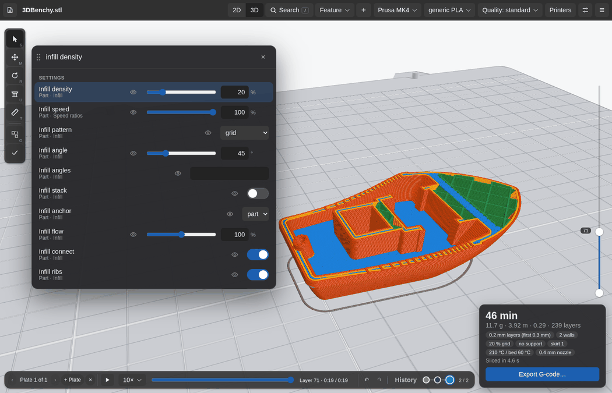

Press `/` (or click **Search** in the header) to search the settings and the actions. Type a few letters, for example `infill`, `brim`, or `export`. A word also finds its other names: `speed` finds the motion settings, `perimeters` the walls, `cooling` the fans, and `temp` the temperatures.

- Each setting in the results has its control: a slider and an entry for a number, a list for a choice, and a switch. Change it in the results. The part slices again at once. A drag of a slider slices as you drag.
- Click the eye of a setting (or press V) to show only the lines that it changes. The other lines become ghosts.
- The tag under each setting gives its section and where its value comes from.
- An action (Export G-code, Print, Arrange the plate, Undo, and others) runs with a click or Enter.
- The search does not block the view. While it is open, you can turn the view, zoom, and click a line.
- Drag its top bar to move it. A double click on the top bar puts it back.
- Keys: Up and Down go through the results. Left and Right change the value. Space or Enter turns a switch or runs an action. Tab goes into the controls. Esc closes the search.

The print card also has the main settings of the print: the layer height, the walls, the infill, the support, the brim or the skirt, the temperatures, and the nozzle. Click one to change it in the search.

### The settings panel

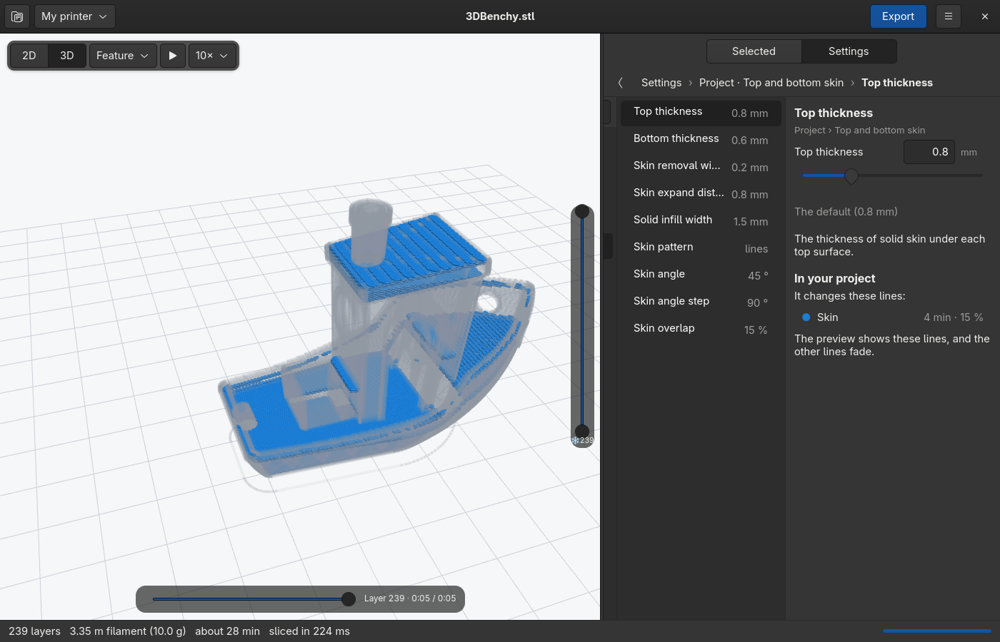

The panel has all settings. Its top row has the path in the settings, one back arrow, **Pin**, and ×. Click a section, then a setting. Each row has the field of the setting (a number with its unit, a switch, or a choice), so a quick change needs no other page. The › at the end of a row opens the page of the setting: its value, its default (with **Reset**), and what it does. The page also lists the lines that it changes, with their share of the print time.

While a setting or a section is selected, the preview shows the lines that it changes. The other lines become faint ghosts, so lines inside the part show. A setting that changes no line shows marks: the seam (a red mark at the start of each outer wall loop), travel moves (blue lines), and retractions (pink marks). A hidden panel shows the whole print.

To change a number:

- Type it. The app uses the value after a short pause, on Enter, or when you leave the field.
- Press Up or Down to step it by one unit of its last decimal place. Hold Shift for 10 steps, or Ctrl for a tenth of a step.
- Drag the name of the setting to the left or the right.
- Drag its slider. The slider covers the usual values. The preview follows as fast as the slicer can go.

Each number has its unit. A speed shows as a ratio of the speed that the printer and the filament allow, for example "50 % = 75 mm/s". A value out of the usual range shows in the warning color, and its tooltip gives the usual range. A value out of the limits of the setting is an error.

The [settings reference](settings.md) explains each setting.

### Where a value comes from

Each setting gets its value from a cascade of levels. A higher level replaces the value of a lower one:

1. **Default:** the built-in value.
2. **Global:** your settings for all prints.
3. **Printer:** the printer profile (the printer menu).
4. **Filament:** the filament profile, or the roll in the printer (the Filament menu).
5. **Quality:** the quality profile: fine (0.1 mm layers), standard (0.2 mm), draft (0.3 mm), coarse (0.4 mm), or your own (the Quality menu).
6. **This print:** your changes for this plate.
7. **This part:** the changes of one part.

A small tag under the name of a setting gives the level of its value ("fine", "Gray", "This print"). A default has no tag. **Reset** goes back to the value under your change.

The bar at the top of the Settings page says what a change is for: **This print (all parts)**, **Global (all prints)**, or one part. A global setting is for every print, for example the seam at the rear, or your usual skirt.

The Filament and Quality menus list the built-in profiles and your own, and have **Save as profile…**. The Quality menu shows a dot when this print has changes on top of the quality. A pick of another quality keeps your changes. See [Profiles](profiles.md) for the files.

The app saves the settings that you change, and loads them at the next start. The Linux app keeps them in `~/.config/zslice/` (`machine.toml`, `filament.toml`, `project.toml`, and `global.toml`). Each file has only the settings that differ from the defaults. If a file does not load, the app says why in its log and keeps a copy with the extension `.bad`.

### Settings for one part

With a part selected, **+ Add a setting for this part** on the part card opens the search for this part. It shows only the settings that a part can have of its own, and a change goes to the part. With more than one part on the plate, the bar of the Settings page can also pick one part.

A part can have its own walls, layer height, seam, speeds, infill, skin, and support. Each part slices as its own job, and the G-code joins the layers of all parts by height. Some settings are for the whole plate, and say "Same for all parts": the temperatures, the fan and the cooling, the travel and the retraction, the first layer height, the skirt, and the brim. A part can also have its own **Quality**, for example a jig in draft next to a figure in fine.

### Settings for some layers

A change in the long form of a line can be for the whole part, for this layer, for this layer and up, or for this layer and down. For example: slower outer walls for the 10 layers of a thin tower. A changed layer shows a reset button. Some settings cannot change for some layers (for example the first layer height). The [settings reference](settings.md) marks the settings that can change for each layer.

A layer profile changes settings for a range of layers (in the GTK and macOS apps):

1. Right-click a line at the height where the change starts, and pick **New profile from here up** (or **from here down**).
2. The Settings page opens with a bar at the top: the name of the profile and its layers. A change goes only to these layers.
3. Click **Done** to stop.

The **Layer profiles** section at the top of the Settings page lists each profile: its layers and how many changes it has. In the bar, the pen renames the profile, and the trash deletes it. A 3MF file keeps the profiles.

### Formulas

A setting can follow other settings. On the page of a setting, type a formula in **Formula** and press Enter. Some examples:

- `= {line_width} * 2`: twice the line width.
- `= max({layer_height} * 4, 0.8)`: four layers, and at least 0.8 mm.
- `= {infill_pattern} == "gyroid" ? 3 : 2`: three walls with gyroid infill, else two.

`{name}` is a setting: its short name (`{layer_height}`) or its full name (`{filament.nozzle_temp}`). A formula has `+ - * / %`, `^` (a power), comparisons, `and`, `or`, `not`, `cond ? a : b`, and the functions `min`, `max`, `round` (`round(x)` or `round(x, step)`), `floor`, `ceil`, `abs`, `sqrt`, `clamp(x, lo, hi)`, and `lerp(a, b, t)`. The value follows each change of the settings that it uses. A plain value in the field removes the formula. A formula with an error turns the field red, and the value stays.

### Path rules

`project.path_rules` (Settings, Speed ratios) changes the speed, the flow, or the fan of the paths that match a formula. Write one rule on each line:

```
speed = {feature} == "outer_wall" and {z} < 5 ? 20 : {speed}
flow = {feature} == "bridge" ? 0.9 : 1
fan = {layer} < 3 ? 0 : {fan}
```

The variables of a path: `{feature}` (`"outer_wall"`, `"inner_wall"`, `"skin"`, `"infill"`, `"bridge"`, ...), `{layer}` (from 0), `{z}` (mm), `{part}`, `{speed}` (the planned speed, mm/s), `{width}` and `{height}` (mm), `{length}` (mm), and `{fan}` (0 to 1). `speed` sets the speed in mm/s, `flow` multiplies the flow, and `fan` sets the fan while the path prints. The rules go in order. A line with an error has no effect. A line that starts with `#` is a note.

### Some settings in detail

- **Gap fill** (`project.gap_fill`, on by default) puts one line along the middle of each narrow area between the walls or in the skin. The width of the line follows the area. On the 3DBenchy, it fills 98 % of the gap area.
- **Retractless skin** (`project.skin_link_length`, 15 mm by default) prints the top and bottom skin of each island in few paths. From the end of a zigzag, the nozzle prints along the walls to the next zigzag, if that way is at most 15 mm long. Set it to 0 to print each piece on its own.
- **Bridges.** A bottom skin over air, with solid plastic at its sides, is a bridge. zslice prints it across the air, in the direction where the longest line is the shortest. The lines go 1.5 mm into the plastic around the bridge, and join there, so the nozzle does not travel over the air. Bridges print at `project.bridge_speed`, with `project.bridge_flow` and `project.bridge_fan`. `project.bridges` turns this off.
- **Ironing** (`project.ironing`). After a layer with a top surface, the nozzle goes over the surface again with close lines (0.1 mm apart) and a small flow (10 %). The hot nozzle melts the surface flat. Each top surface gets about 4 times as many lines as its skin.
- **Slope smoothing** (`project.slope_smoothing`, experimental). A sloped top prints as a stair. After each layer, the nozzle goes back along the edge and lays a small bead in the corner of each step. The bead has its own height at each point, so its G-code has a Z on each move. It adds about 7 % to the time of a Benchy. `machine.nozzle_tip_radius` and `machine.nozzle_cone_angle` describe your nozzle, so that it stays clear of the layer above.
- **Slope ironing** (`project.slope_ironing`) irons the filled steps with a very small flow, from the top of the step to its edge.
- **Wipe inside the part** (`project.retract_wipe`). At each retraction, the nozzle moves on a small arc inside the part while the filament pulls back. Use it with stringy filament (PETG, TPU).
- **Infill anchor** (`project.infill_anchor`). The grid of the sparse infill starts at the center of each part, so each copy of a part gets the same infill. Set it to `bed` for one grid for all parts.
- **Pictures for the printer screen** (`machine.thumbnails`). Set it to the sizes that your printer wants, for example `300x300,32x32`.
- **Where the part goes** (`project.placement`). `auto` keeps the X and Y of the file if the part is on the bed there. Else it puts the part at the center of the bed. `file` and `center` always do one or the other. If the G-code origin of your printer is not the front left corner, set `machine.origin_x` and `machine.origin_y`.

### Compare with Cura

In the GTK app, **Compare with Cura…** (in the search) shows your zslice settings next to the settings of the active printer of Cura. zslice reads the Cura files on this computer, and does not change them. Each row has the zslice setting, its group, the value in zslice, the value of Cura, and the Cura key. **Use** sets the Cura value in zslice, and **Use all** sets each value that differs. Undo removes a change again. The mapping is the same as in `zslice import cura` (see [Profiles](profiles.md)).

## Support

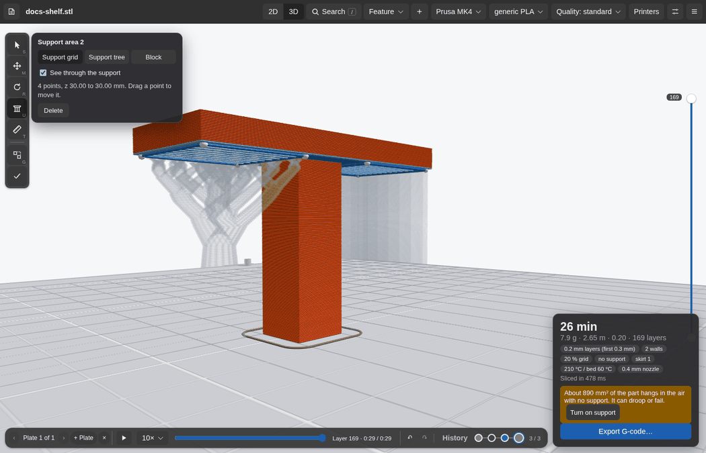

### Support from the settings

Turn on support in the search (`support`), or with **Turn on support** on the print card. **Support style** is grid or tree:

- **Grid support** prints straight walls under each overhang, with interface layers on the top.
- **Tree support** grows branches from the bed to each overhang. zslice plans the branches first. A branch gets wider on the way down, and never thinner, so it can stand. A tip 30 mm up gets a branch about 4.4 mm across. A branch prints hollow, as one wall loop, with a few solid layers at the bed and under each tip. Tree support reaches into deep, narrow holes.

`project.support_angle` sets how flat an overhang must be to get support.

With support off, the web app checks the print after each slice. When overhangs and shapes in the air add up to 20 mm² or more, the print card says how much hangs in the air, with **Turn on support**. Bridges do not count.

### The Support tool

The Support tool (U) draws support areas on the part. Support grows under an area, or a Block area keeps support out. An area works also where the support angle gives no support, and also with support off.

1. Press U. A card shows at the top left of the view.
2. Pick the kind on the card: **Support grid**, **Support tree**, or **Block**.
3. Turn the view so that you see the surface that needs support. For the bottom of a shelf, look from below.
4. Click points on the surface around the area. A point snaps to the end of the nearest line. Hold Shift for no snap.
5. Click the first point again, or press Enter, to close the area. The plate slices again.

Support grows under all of the surface in the area that faces down, between the lowest and the highest point that you clicked.

While the tool is on, the support lines are faint, so the outlines of the areas show through them. Clear **See through the support** on the card to see them solid.

To edit an area:

- Click its outline to select it. The card shows its kind, its points, and its heights.
- Drag a point. The outline follows the pointer, and the plate slices when you release it.
- Change the kind on the card, or press Delete (or click **Delete**) to remove the area.

Keys while you draw: Backspace removes the last point, and Esc stops the area. The project file and the plate 3MF keep the areas, and Ctrl+Z undoes each change.

### Support marks

Right-click a line for **Add support here** › Grid, Tree, or Bridge (a pad): support of that kind under a 3 mm disk at that place. **Block support here** keeps the support of the settings out of that place.

## Measure and check

### The measure tape

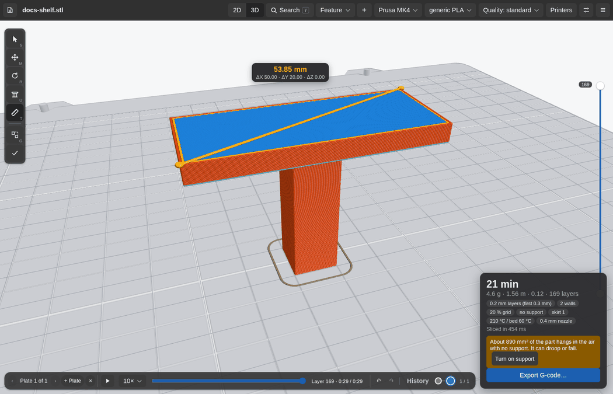

With the Measure tool (T), two clicks measure between two points of the print or the bed, in the 3D or the 2D view. A gold line joins the points. The label gives the distance, its parts along X, Y, and Z, and the distance on the bed.

- A point near the end of a line snaps to it. Hold Shift for no snap.
- A click on a circle or an arc (a hole, a boss) gives its diameter and radius, and puts the point at its center. So two holes give the distance between their centers.
- Esc clears the measure.

### Gaps

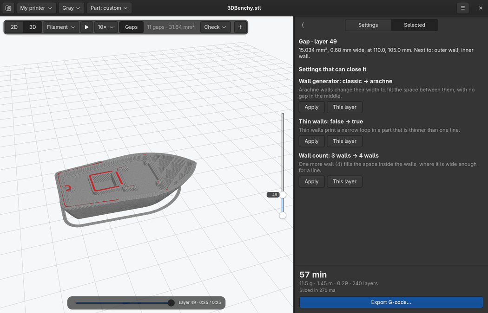

Turn on **Gaps** (G) to see the gaps of the top layer in red: the areas that should be solid that no line covers. The sparse infill does not count. The header gives the number of gaps and their area.

Click a gap. The panel gives its size, its width, the lines next to it, and the settings that can close it, the best first, with the value to try and why. **Apply** changes the setting for the print. **This layer** changes it only for the layer of the gap. The part slices again, and the panel shows the same gap with the new settings, or says that it is closed.

Gap fill (on by default) closes most gaps. On the Benchy at layer 50, it leaves 4 small gaps of 0.2 mm² in all. Turn it off to see the gaps that it fills.

### Check the print

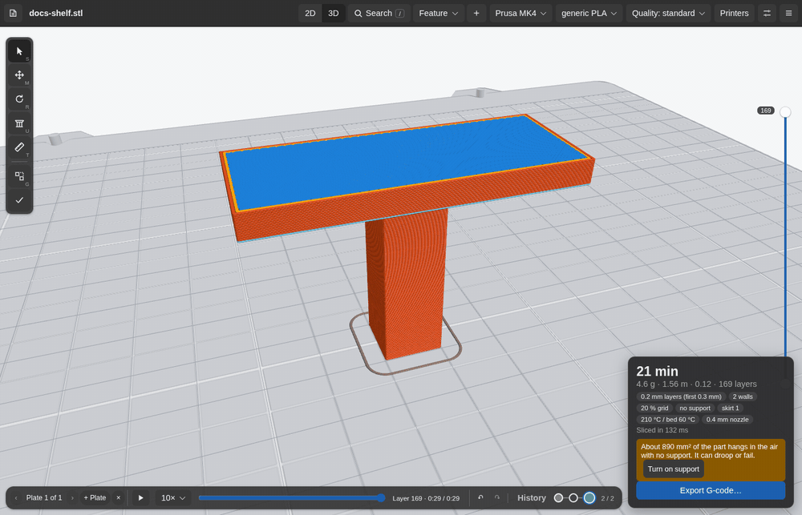

**Check** (the last button of the tool strip) lists what can make the print fail or print badly, the worst first:

- an overhang with support off, flatter than `project.support_angle`;
- a bridge, with its span (a long bridge can sag);
- a shape that starts in the air (an island);
- a line that needs more plastic than the hot end melts (`filament.max_flow`);
- layers that print in less than `filament.min_layer_time`;
- a layer with many retractions.

Each issue says what it is and which setting changes it. Click an issue: the view goes to its layer, and selects the line of the issue.

## Plates and projects

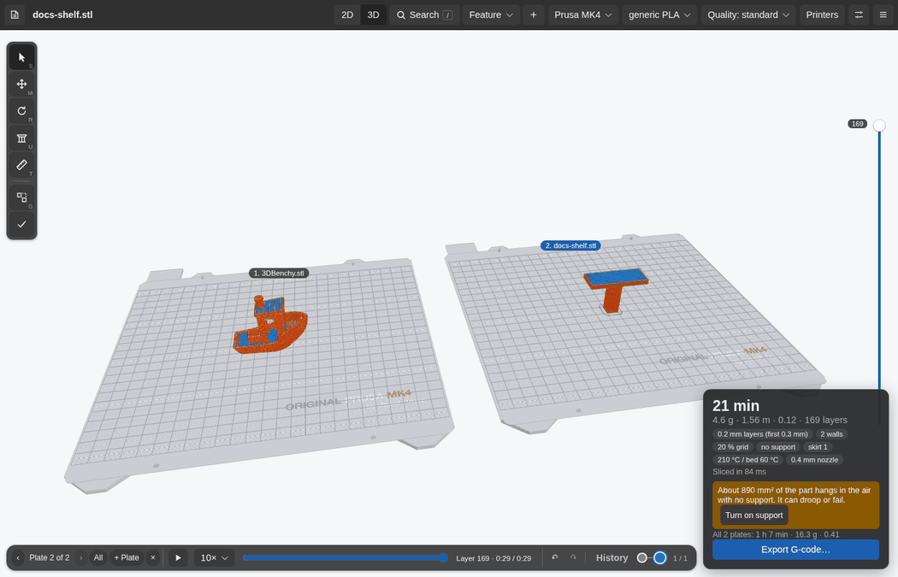

### Plates

Each plate has its own parts, settings, changes, support areas, and undo history. The dock has the plates:

- ‹ and › go to the plate before and the next plate.
- **All** (Home) shows all plates, in a row. F shows the active plate.
- **+ Plate** adds an empty plate after the others, with the settings of the active plate.
- **×** removes the active plate. A plate with parts asks first. You cannot undo a removal.

`]` and `[` make the next plate or the plate before active. All plates slice: the active plate first, then the others. The GTK app shows the active plate only.

**Make [10] in all** on the part card makes copies of the part until there are that many: on its plate while they fit the bed, then on new plates. With two plates or more, the print card shows the sums of all plates, for example "All 3 plates: 20 h 12 min · 292 g · 7.31". The cost counts the filament (`filament.price_per_kg`) and the time of the printer (`machine.hour_rate`, 0 at first).

**To a new plate** on the part card moves the part to a new plate. Use it after a cut, when the parts do not fit on one bed.

In the GTK app, **Send all plates** sends each plate to the current printer, and **Export all plates…** writes one file for each plate into a folder.

### Save the project

**Save project…** (Ctrl+S, in the main menu) writes all plates into one 3MF file. The file has the parts of each plate at their places, their settings, the changes for some layers, the support areas, and the line edits. It also has the printer, the filament, and the print settings of each plate. Open the file (Ctrl+O, or a drop on the view) to get all plates back. Another slicer opens the same file as its first plate.

zslice also opens 3MF files from other slicers. Parts that touch in the file (for example a sign and its text) stay one part.

### Open a project

**Open a project…** in the main menu opens a project from a folder or from GitHub: a repository with a `printdeck.yml` file. The plates of the project show in a row, and each plate slices. The Project dialog lists the plates and the parts, and the state of each plate. See [Projects](projects.md).

### Cura projects

zslice opens a Cura project (a 3MF file that Cura saved), with the settings of each object:

- **Settings of a part.** zslice changes each Cura setting to its own setting, for example `infill_sparse_density` to `project.infill_density`. If the parts have different settings, each part slices with its own settings.
- **Modifier volumes.** A Cura "infill mesh" does not print. It changes the infill of the part that it overlaps: its pattern, density, angles, speed, and flow. A volume with no walls and no top and bottom layers also removes the skin there. This is how a speaker grille works.
- **Other volume types.** zslice does not support Cura cutting meshes, anti overhang meshes, and support meshes yet.

The part card lists the settings of the part and of its volumes, each with the zslice setting that it becomes, or why zslice does not use it. The 3D view draws each volume as thin purple rings. Some infill settings help with a grille: `project.infill_angles` (one angle for each layer in turn), `project.infill_stack` (the lines of each layer lie on the lines below), `project.infill_flow`, and the `trihexagon` pattern.

## Printers

### Add a printer

Pick **Add a printer…** at the end of the printer menu in the header. At the first start, the picker opens by itself.

1. The picker opens on **Popular**: 15 printers that most people have. Type a part of a name in the search: "ender 3", "mk4", "k1 max", "voron 2.4". Or pick a brand at the left.
2. Click a model. The card at the right draws its build volume to scale. The red dot is X0 Y0 of the G-code. The card also lists the nozzle, the filament, the heating, the firmware, and the motion limits.
3. Click **Next** (or double-click the model). Check the name, the nozzle, the filament diameter, and the size. Set the connection.
4. Click **Add printer**. The printer is now the current printer.

The library has more than 1000 printers of more than 180 brands, from the printer definitions of Cura, PrusaSlicer, and OrcaSlicer. The print speed (`machine.max_speed`, the base of the speed ratios) follows the acceleration of the printer: 100 mm/s below 1000 mm/s², then 150, 200, and 300 mm/s from 10000 mm/s². If your printer is not in the list, pick "My printer is not in the list": the generic printer, with the size that you enter.

For most printers of the library, the 3D view shows the bed of the printer under the plate, with the print of its sheet. The setting `machine.model` has the id of the model in the library, for example `prusa-mk4s`. Clear it to see the grid alone.

### Printers on your network

The Linux and macOS apps search the local network, and list the printers that they find under "On your network": OctoPrint, printdeck, Moonraker (Klipper), PrusaLink, and Bambu Lab (macOS). Click one, and zslice fills its address and its kind. The web app cannot search the network, because browsers block the mDNS packets. Enter the address of the printer yourself.

### Connections

Each printer has its own machine settings and a connection:

- **None**: export a G-code file.
- **printdeck** or **OctoPrint**: the address of the printer and its API key.
- **Moonraker** (Klipper): the address of Moonraker.
- **USB** (GTK app): the serial port and the speed. The app sends the print line by line, so the computer must stay on while it prints.
- **Bambu Lab** (LAN mode, in the macOS app): see [The macOS app](macos.md).

**Test the connection** shows what the printer tells: its state, its bed and nozzle, its motion limits, and the filament in it. **Use the printer's bed, nozzle, and motion** copies these values to the printer settings, and **Use the filament in the printer** copies the filament.

**Get a key** asks the printer for an API key for zslice. The printer asks "Allow zslice to use the Printdeck?" on its touch screen (printdeck), or in its web page (OctoPrint, with the App Keys plugin). While the printer asks, the app shows the id of its own key. Make sure that the deck shows the same id. Allow it within 2 minutes, and zslice keeps the key. You can also copy the key: printdeck shows it on its System page, and OctoPrint in Settings › API.

A printdeck with a secure address (`https://….d.printdeck.beetlebug.org`, on its System page) works from the web app in any browser. zslice tries the secure address first. The Linux and macOS apps trust the certificate of the printer at the first connection. They stop a send if the printer later shows another certificate.

### Signed prints

Each G-code file that zslice exports or sends ends with a signature line. The app makes its own key at the first start. The web app keeps the key in the browser (IndexedDB), the GTK app in `signing.key` in its settings folder, and the macOS app in the Keychain. **Get a key** gives the public key to a printdeck. A printdeck that does not trust the key refuses the print, and the app says why. OctoPrint and Moonraker do not check signatures: the printer list says "not verified".

### Send and print

Pick the printer in the printer menu. With a connection, the button of the print card is **Print**: it puts the G-code on the printer and starts the print. Its menu has **Upload only** and **Export a G-code file…**. Before each print, zslice asks if the bed is clear. A printdeck set to ask (a farm) keeps the file until a person presses Print on the deck, and zslice says so.

If a part is off the bed, the print card shows a red warning, and an export or a send asks first. The printer can hit its frame or the other part.

With a printdeck printer, the print card also shows the estimate of the printer after each slice, for example "LulzBot TAZ Workhorse: 1 h 41 min (3 min start)". printdeck learns it from its past prints. zslice sends the G-code (compressed) for the estimate. The printer does not keep the file or print it. printdeck also tells which roll is in the printer and how many grams are left on it. The cost of the print uses the price of that roll. Each roll keeps its own filament settings ("Keep filament settings for each roll in the printer", on by default).

### The start and end G-code

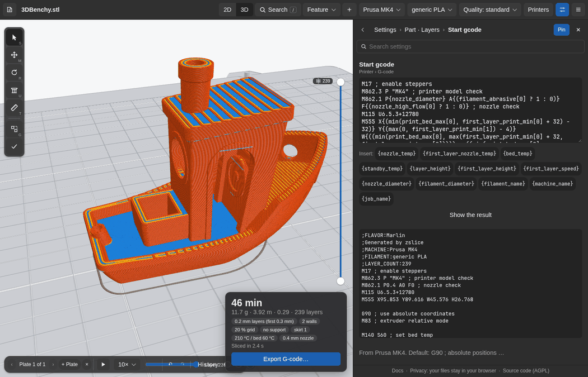

Open the setting **Start gcode** or **End gcode** (search `start gcode`). The editor spans the panel. Under it, each variable of zslice is a button: a click puts the variable at the cursor. **Show the result** shows the start of the G-code of the last slice with the values (or its end, for the end G-code). Look at the start G-code before the first print on a new printer.

## Print farm

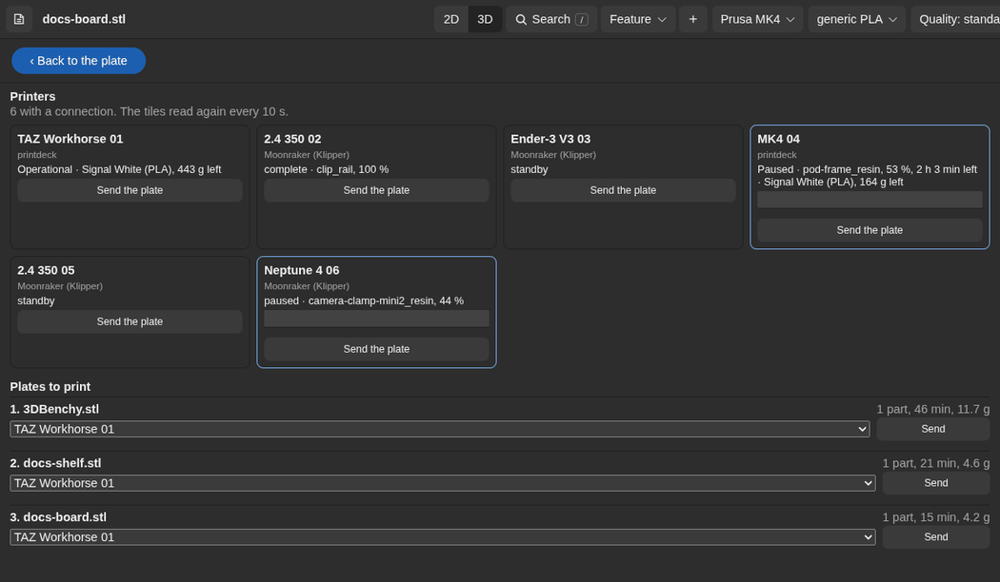

The **Printers** page shows all your printers with a connection, side by side. Open it with **Printers** in the header (or the main menu). It covers the view. **‹ Back to the plate** returns. The tiles read again every 10 seconds while the page shows.

- Each tile has the state of the printer, its job with the progress and the time left, and the filament in it.
- **Send the plate** on a tile sends the active plate to that printer.
- **Plates to print** lists each plate with parts, with its time and its plastic. Its menu lists the printers that fit the plate, the free printers first. A busy printer says when it is free ("busy, free in 1 h 5 min"). A printer with a bed smaller than the plate is not in the menu.
- A plate that you sent has a check mark and "sent to <printer> at <time>".

Each send asks first: "Is the bed clear?". It also warns when the printer looks busy, or when the plate is sliced for another printer. The macOS app adds a queue, a summary of the farm, and notifications (see [The macOS app](macos.md#a-farm)). To try a farm on one computer, run the farm simulator of the source tree (`tools/farm_sim/README.md`).

## History and undo

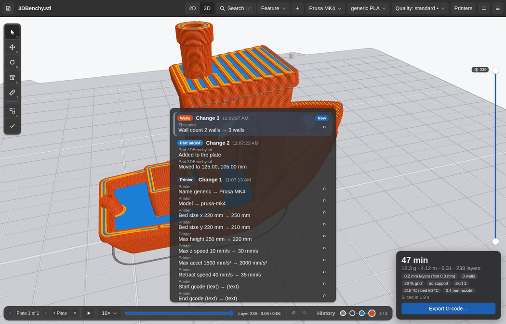

Ctrl+Z undoes a change of the settings or of the plate: a move, a turn, a scale, a removed part, an edit of a line, or a support area. Ctrl+Shift+Z (or Ctrl+Y) redoes it. A drag of a slider is one step. The undo list keeps 100 steps. On a plate of large parts, the oldest steps go first, so that the plates in the list stay under 200 MB.

The dock shows the history:

- ↶ and ↷ undo and redo.
- One mark for each change, the oldest at the left. The color and the glyph of a mark give the kind of change, for example walls, infill, speed, support, the printer, or the place of a part. Point at a mark to see its changes in words. Click a mark to go back to that change: the preview slices as it was then. The changes after it stay (dimmed) until you edit something.
- **History** opens the list of the changes over the dock. Each change has its time, its values, and its scope: the printer, the filament, this print, a part, or a layer range ("Layers 86 and up"). The newest change is first. Click a change to go back to it, or use ↑ and ↓. Space goes back to the change before, so you can compare two changes. The ↶ button of one setting in a change undoes only that setting, and keeps the later changes. The list also has the line edits.

## Keyboard

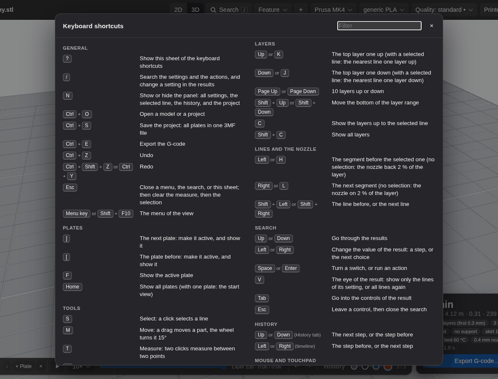

Press `?` to see all keyboard shortcuts of the app (in the GTK app, also in the main menu). Type in the sheet to filter it. Esc closes it. On the Mac, Command replaces Ctrl.

| Keys | Action |
|---|---|
| **General** | |
| `?` | Show the sheet of the keyboard shortcuts |
| `/` | Search the settings and the actions |
| N | Show or hide the settings panel |
| Ctrl+O | Open a model or a project |
| Ctrl+S | Save the project: all plates in one 3MF file |
| Ctrl+E | Export the G-code |
| Ctrl+Z | Undo |
| Ctrl+Shift+Z, Ctrl+Y | Redo |
| Esc | Close a menu, the search, or the sheet; then clear the measure, then the selection |
| Menu key, Shift+F10 | The menu of the view |
| **Plates** | |
| `]` | The next plate: make it active, and show it |
| `[` | The plate before: make it active, and show it |
| F | Show the active plate |
| Home | Show all plates |
| **Tools** | |
| S | Select: a click selects a line |
| M | Move: a drag moves a part, the wheel turns it 15° |
| R | Turn: drag a ring of the selected part to turn it about X, Y, or Z |
| U | Support: draw a support area, and drag the points of an area |
| T | Measure: two clicks measure between two points |
| G | Gaps: show the gaps of the top layer |
| Enter (Support tool) | Close the area that you draw |
| Backspace (Support tool) | Remove the last point of the area |
| Delete (Support tool) | Delete the selected support area |
| Esc (Support tool) | Stop the area, then clear the selected area |
| Ctrl+click, Ctrl+drag, Ctrl+wheel | Select, move, and turn a part with any tool |
| Tab, Shift+Tab | Select the next part, or the part before |
| Arrow keys (a part) | Move the selected part 1 mm (with Shift: 10 mm) |
| Left, Right (Turn tool) | Turn the selected part on the bed, 15° (with Shift: 5°) |
| Up, Down (Turn tool) | Tilt the selected part about X, 15° (with Shift: 5°) |
| Page Up, Page Down (Turn tool) | Tilt the selected part about Y, 15° (with Shift: 5°) |
| D | Duplicate the selected part |
| Delete (a selected line) | Take the line out of the print |
| Delete | Remove the selected part |
| Shift+click | Add a line to the selection |
| Shift (measure, support) | No snap |
| **Layers** | |
| Up, K | The top layer one up (with a selected line: the nearest line one layer up) |
| Down, J | The top layer one down (with a selected line: the nearest line one layer down) |
| Page Up, Page Down | 10 layers up or down |
| Shift+Up, Shift+Down | Move the bottom of the layer range |
| C | Show the layers up to the selected line |
| Shift+C | Show all layers |
| **Lines and the nozzle** | |
| Left, H | The segment before the selected one (no selection: the nozzle back 2 % of the layer) |
| Right, L | The next segment (no selection: the nozzle on 2 % of the layer) |
| Shift+Left, Shift+Right | The line before, or the next line |
| **Search** | |
| Up, Down | Go through the results |
| Left, Right | Change the value of the result: a step, or the next choice |
| Space, Enter | Turn a switch, or run an action |
| V | Show only the lines of the setting, or all lines again |
| Tab | Go into the controls of the result |
| Esc | Leave a control, then close the search |
| **History** | |
| Up, Down (History list) | The next change, or the change before |
| Left, Right (the marks on the dock) | The change before, or the next change |

The mouse and the touchpad are in [Move the view](#move-the-view).

## For each platform

### The web app

[zslice.beetlebug.org](https://zslice.beetlebug.org/) runs the zslice core in WebAssembly, in your browser. It needs WebGL2 (Chrome, Firefox, or Safari of 2023 or later).

- **Your files stay in your browser.** The model slices on your computer, in a Web Worker. No file goes to a server. The page has no analytics and no cookies. See [Privacy](../../PRIVACY.md).
- **Your work stays after a refresh.** The page keeps the plate, your settings, and your printers in the storage of the browser.
- **Open a model from a link.** Add `?model=` and the address of an STL file to the page address.
- **Printers.** The web app cannot search the network. Enter the address of the printer. The printer must allow requests from the page (CORS headers), for example a printdeck at its secure address.
- **Signed prints.** The key of the web app is in the browser. A browser with no Ed25519 support says so at the first export or send.

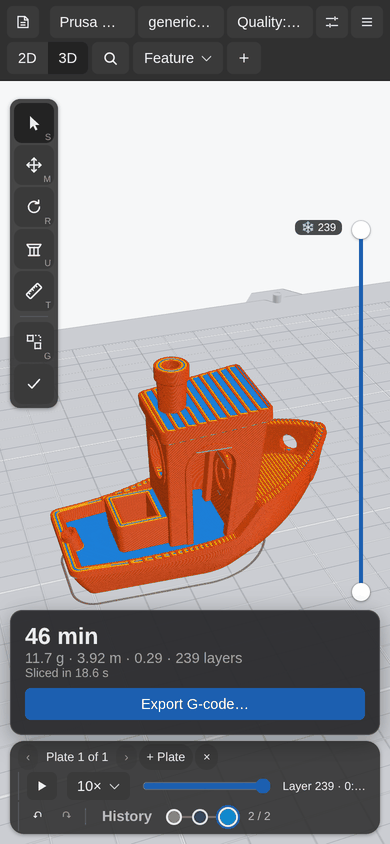

On a phone, the window fits the screen. The header keeps Open and narrows the menus. The printer picker is one column: the search and the list, then the card of the printer. The print card sits over the dock and hides its settings. One finger orbits the view, and two fingers pinch to zoom and pan.

### The Linux app

The Linux app is a GTK 4 app. Build it from the source tree:

```sh
cd linux
meson setup build        # builds the core too (zig build lib)
ninja -C build
build/zslice-gtk part.stl
```

See [linux/README.md](../../linux/README.md) for the packages. The GTK app differs from the web app in some places:

- Alt+Left and the back button of the mouse go back to where you were before, also from the settings to the long form of a line.
- It shows the active plate only.
- Preferences (Ctrl+,) has the Printers page: the connection, **Test the connection**, and **Get a key** for each printer. The API keys are in `~/.config/zslice/app.ini`, which only you can read.
- It has layer profiles, **Compare with Cura…**, USB printers, **Send all plates**, and **Export all plates…**.
- The background of the view follows the theme of the app. The theme follows the system, unless Preferences sets one.

### The macOS app

The macOS app is a SwiftUI app with a Metal view. See [The macOS app](macos.md): its keys, its settings pane, Bambu printers, the Keychain, and the farm queue.
