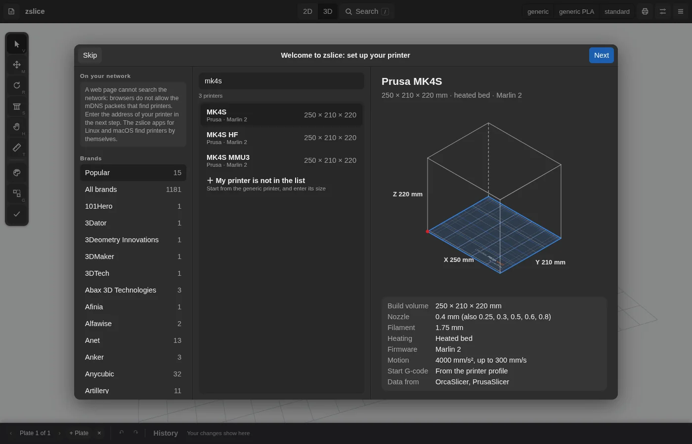
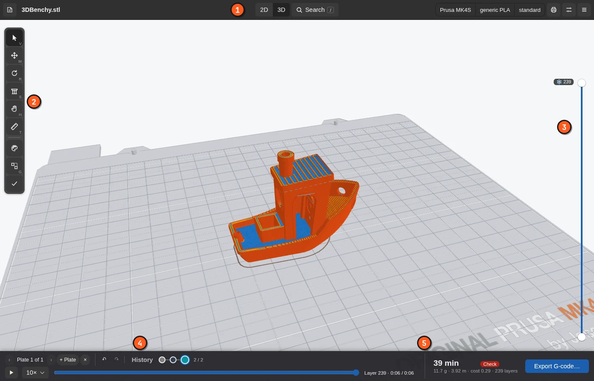
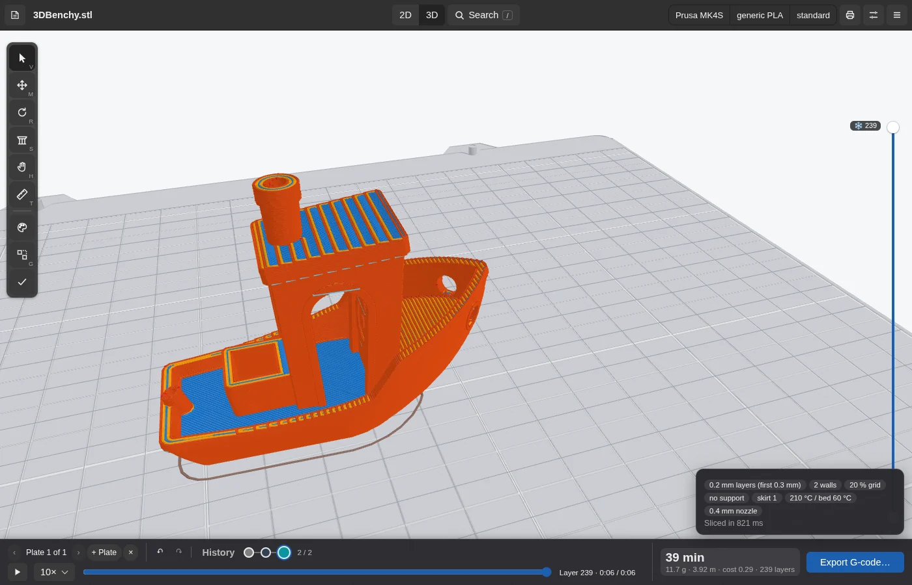

# Your first print

Open a model, slice it, and print it. You need only this page.

## The steps

1. **Open zslice.** Go to [zslice.beetlebug.org](https://zslice.beetlebug.org/). The web app needs no install. For the Linux and the Mac app, see [Web, Linux, and Mac](apps.md).
2. **Pick your printer.** The picker opens at the first start. Type a part of the name, for example "ender 3" or "mk4". Click the printer, then **Next**, then **Add printer**.
3. **Open a model.** Drop an STL, 3MF, OBJ, or STEP file on the view, or click **Open a model** on the plate. zslice slices the model at once.
4. **Pick the filament and the quality.** Use the two menus next to the printer in the header, for example "generic PLA" and "standard" (0.2 mm layers).
5. **Look at the print.** Drag to turn the view. Turn the wheel to zoom. The print card at the bottom right gives the time and the plastic.
6. **Print.** Click **Export G-code…** and copy the file to your printer. With a printer connection, the button is **Print**.

## The window

The letters in the picture name the parts of the window.

| | Part | What it does |
|---|---|---|
| A | The header | Open, **Search** (`/`), the printer, the filament, the quality, Printers, the settings panel (N), and the main menu. |
| B | The tools | Select (V), Move (M), Turn (R), Support (S), Grab (H), Measure (T), then the colors, Gaps (G), and Check. |
| C | The layer slider | The top knob is the top layer that shows. The bottom knob cuts away the layers below it. |
| D | The dock | The plates, the history, and the replay of the print. |
| E | The print card | The time, the plastic, and the cost. Click the time for the details. Then **Export G-code…** or **Print**. |

## Read the notes

The print card can show a note in a colored box. Read it before you print.

| The note says | Do this |
|---|---|
| The part hangs in the air with no support | Click **Turn on support**. |
| The part is very small: was the file in inches or in meters? | Click **Inches (×25.4)** or **Meters (×1000)**. |
| A part is off the bed or on another part (red) | Move, turn, scale, or cut the part. |

## Where to go next

- → [Look at the print](look.md): turn the view, go through the layers, and replay the print.
- → [Click a line](lines.md): see what a line is, and why it prints as it does.
- → [Change a setting](change-settings.md): search with `/`, and see the change at once.
- → [The best features](features.md): the print as it forms, parts with real physics, and more.
