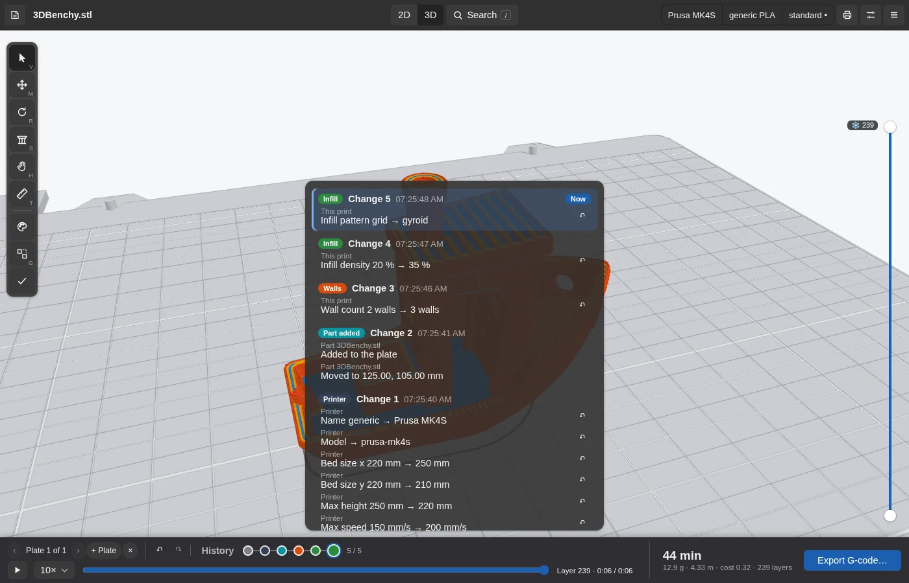

# Undo and history

Each change is a step. Go back to any step, and see the print as it was then.

## Undo

- Ctrl+Z undoes a change: a setting, a move, a turn, a scale, a removed part, an edit of a line, a support area, or a click or a stroke of the Paint tool.
- Ctrl+Shift+Z (or Ctrl+Y) redoes it.
- A drag of a slider is one step. The list keeps 100 steps.

## The buttons on the dock

The dock has three buttons after the plates:

- ↶ undoes a change.
- ↷ redoes it.
- The clock opens the History list.

A small number on the clock counts your changes since you opened or saved the file. Point at the clock to see the number of changes.

## The History list

Click the clock, or press Ctrl+H. The list opens over the clock. Esc closes it.

- The newest change is at the top.
- Each change has a glyph and a color for its kind: walls, infill, speed, support, the printer, or a part.
- Each change has its time, its values, and its scope: the printer, the filament, this print, a part, or some layers.
- Click a change to go back to it, or use ↑ and ↓. The print slices as it was then.
- The later changes stay, dimmed, until you edit something.
- **Clear the later changes** under the list removes them. Redo cannot bring them back.
- The ↶ of one setting undoes only that setting, and keeps the later changes.
- Double-click a setting to edit it.
- Right-click a change to go to it, or to clear the history after it.

A change that touches some layers also has a mark on the layer slider.

## Where to go next

- → [The best features](features.md): what zslice does that other slicers do not.
- → [Keys and mouse](keys.md): all the keys.
