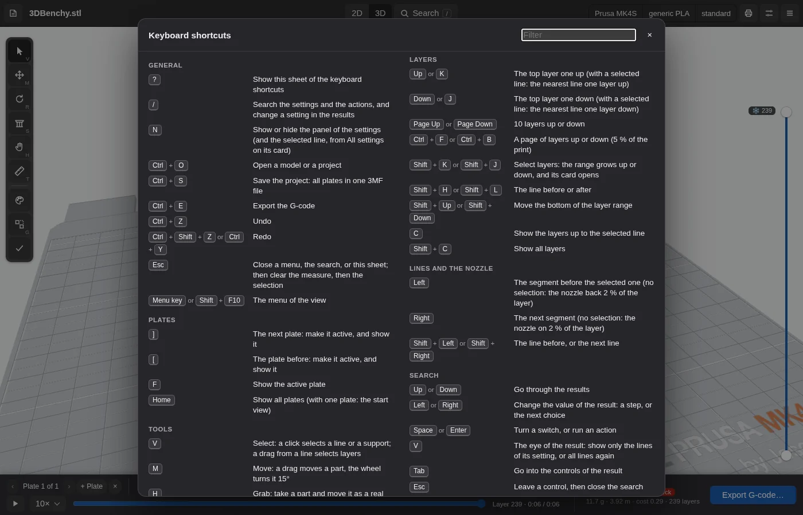

# Keys and mouse

Press `?` in the app to see all keys. Type in the sheet to filter it. On the Mac, Command replaces Ctrl.

## General

| Keys | What they do |
|---|---|
| `?` | The sheet of the keys |
| `/` | Search the settings and the actions |
| N | Show or hide the settings panel |
| Ctrl+O | Open a model or a project |
| Ctrl+S | Save the project: all plates in one 3MF file |
| Ctrl+E | Export the G-code |
| Ctrl+Z | Undo |
| Ctrl+Shift+Z, Ctrl+Y | Redo |
| Esc | Close a menu, the search, or the sheet. Then clear the measure, then the selection. |
| Menu key, Shift+F10 | The menu of the view |

## Tools

| Keys | What they do |
|---|---|
| V | Select: a click selects a line |
| M | Move: a drag moves a part, the wheel turns it 15° |
| R | Turn: drag a ring of the selected part |
| S | Support: click an overhang, or draw an area. S again opens or closes the card of the tool. |
| H | Grab: pick up a part, carry it, and let go |
| T | Measure: two clicks |
| G | Gaps of the top layer |
| Ctrl+click, Ctrl+drag, Ctrl+wheel | Select, move, and turn a part with any tool |
| Tab, Shift+Tab | The next part, or the part before |
| Arrow keys (a selected part) | Move the part 1 mm (Shift: 10 mm) |
| ←, → (Turn tool) | Turn the part on the bed, 15° (Shift: 5°) |
| ↑, ↓ (Turn tool) | Tilt the part about X |
| Page Up, Page Down (Turn tool) | Tilt the part about Y |
| D | Duplicate the selected part |
| Delete | Remove the selected part, or take the selected line out of the print |
| Shift (Measure, Support) | No snap |
| Enter, Backspace, Esc (Support tool) | Close the area, remove its last point, stop it |

## Layers and lines

| Keys | What they do |
|---|---|
| ↑ or K, ↓ or J | One layer up or down. With a selected line: the nearest line one layer up or down. |
| Page Up, Page Down | 10 layers up or down |
| Shift+↑, Shift+↓ | Move the bottom of the layer range |
| ←, → | The segment before or after the selected one. No selection: the nozzle back or on 2 % of the layer. |
| Shift+←, Shift+→ | The line before, or the next line |
| C | Show the layers up to the selected line |
| Shift+C | Show all layers |
| Shift+click | Add a line to the selection |

## Plates

| Keys | What they do |
|---|---|
| `]`, `[` | The next plate, or the plate before |
| F | Show the active plate |
| Home | Show all plates |

## Mouse and touch

| Mouse or touch | What it does |
|---|---|
| Right drag (hold the right button) | Orbit. On a touchpad: press down two fingers and drag. |
| Left drag | Orbit |
| Middle drag, or Shift and a drag | Pan |
| Wheel, light two-finger swipe, pinch | Zoom toward the pointer |
| Double-click a side of a part | Face that side, and zoom to it |
| Double-click elsewhere | Reset the view |
| Right click | The menu of the view |
