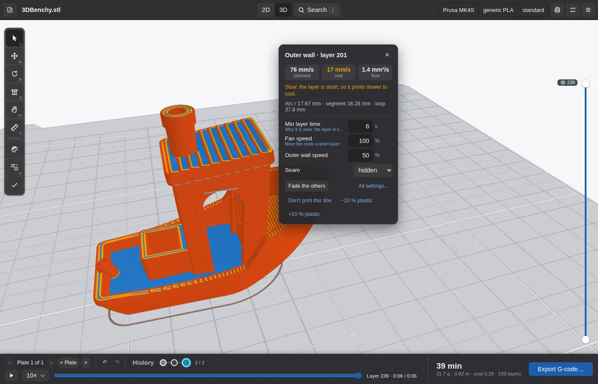

# Click a line

Click any line of the print. A card says what the line is, how fast it really prints, and why.

## The card of a line

Use the Select tool (V), and click a line in the 2D or the 3D view. The line turns yellow. The card opens in a corner of the view, away from the line, so it covers no part of the line. It stays in that corner from click to click. It moves only when the next line is under it. The card shows:

- the feature, the layer, and the z, for example "Outer wall" and "Layer 201 · z 40.30 mm";
- the speed, and the planned speed when the line is slower;
- the flow, and how much of the flow limit of the filament it uses;
- the line width and height, the time of the layer, and the fan;
- why the line is slow, in plain words: a short layer, short segments, or the flow limit;
- a warning of the check at the line, for example a bridge or an overhang, after the check has run;
- for a support line: the part line that it holds up, and how many layers up;
- the settings that matter for this line, each with its field. Change one, and the part slices at once. Click the name of a setting to show it in the panel.

| Button | What it does |
|---|---|
| **Fade the others** | Shows the line solid and the other lines as faint ghosts. |
| **All settings…** | Opens the long form of the line in the panel: each number, and how it comes about. |
| **Don't print** | Takes the line out of the print. Delete does the same. |
| **−10 % plastic**, **+10 % plastic** | Gives the line less or more plastic. |

Esc, ×, or a click on no line closes the card. Drag the top row of the card to move it.

## Go along the print

With a line selected:

- ← and → go to the segment before or after it, in print order. Shift goes one line.
- ↑ and ↓ (or K and J) go to the nearest line on the layer above or below.
- C shows the layers up to the line. Shift+C shows all layers.

## Select layers

Use the Select tool (V). Press on a line, and drag up or down. The layers from that line to the layer under the pointer turn yellow, and the other lines fade. Release the button: a card opens beside the layers, and it covers no part of them. It shows "Layers A–B" and the settings that can change for some layers: the infill density and pattern, the walls, the speeds, the fan, and the temperature. "+ Add a setting for these layers" finds the others. A change is for these layers only, and the part slices at once. Esc, ×, or a click elsewhere ends the selection.

A drag that starts on the bed or in the air turns the view.

## Select a support

Use the Select tool (V), and click a support line:

- Tree support: the dots of that tree show. Drag a dot, its ring, or a segment to pull it, as in the Support tool. Right-click a dot for **Delete branch**.
- Grid support: the overhang that the support holds up shows in blue. Delete, or **Remove this support** on the card, takes the support away there.

## The menu of the view

Right-click a line (or press Shift+F10):

- **Preview to this layer**, and **Show all layers**;
- **Add support here** and **Block support here**. See [Add support](support.md);
- **Copy for AI**: a report of the line, its settings, and its G-code, for a chat with an AI model;
- **Add a drop of plastic here**: a dot of plastic on the top layer, to fill a small gap;
- **Test print: the top layer…**: the G-code of this layer alone, to print as a test;
- **Put this side on the bed**, and **Placement**. See [Place the parts](parts.md).

Each edit of a line is one step of the history. Ctrl+Z undoes it. The project file keeps it.

## Where to go next

- → [Change a setting](change-settings.md): search, the panel, and settings for some layers.
- → [Check the print](check.md): gaps, the check list, and the measure tape.
