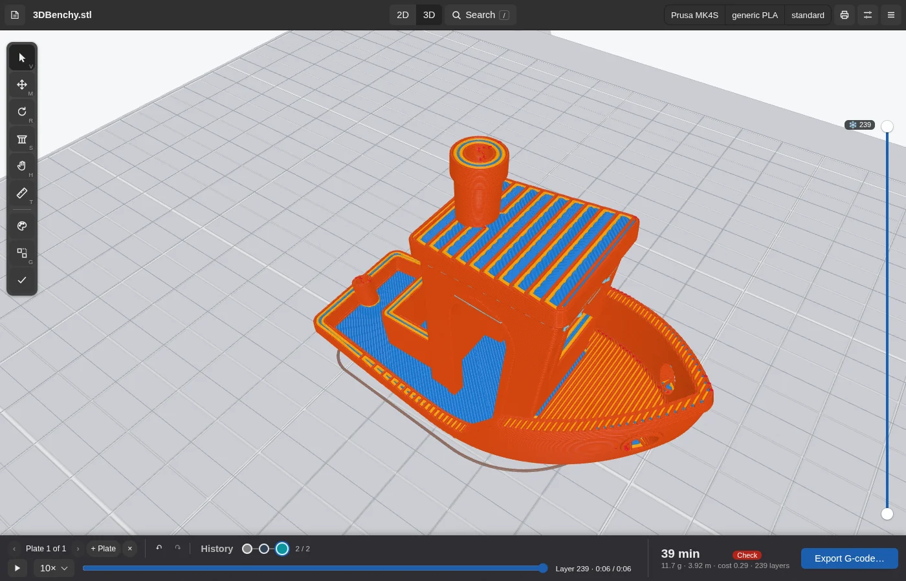
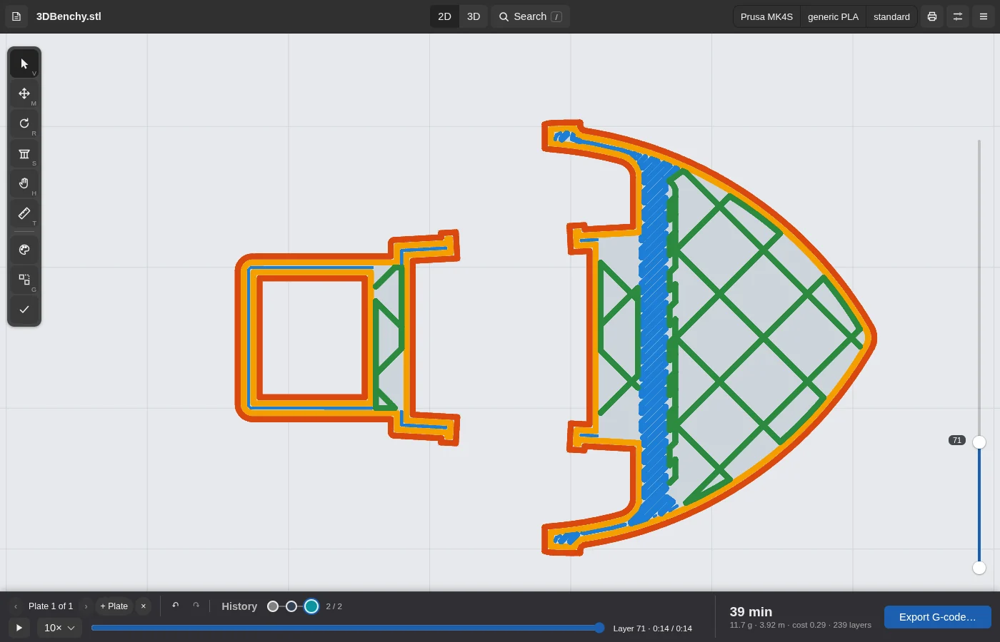

# Look at the print

Turn the view, go down through the layers, and replay the print as the printer prints it.

## Move the view

| Mouse or touch | What it does |
|---|---|
| Left drag | Orbit around the part. The bed stays level. |
| Middle or right drag | Pan. On a touchpad: click down with two fingers and slide. |
| Wheel, light two-finger swipe, or pinch | Zoom toward the pointer. |
| One finger (touch screen) | Orbit. |
| Two fingers (touch screen) | Pinch to zoom. Move them to pan. |
| Double-click a side of a part | Turn the view to face that side. |
| Double-click elsewhere | Reset the view. |

## 2D or 3D

- **3D** shows the print as beads. Skin lines are pressed flat. Connected lines look connected.
- **2D** shows the top layer from above.

## The colors

The colors button in the tool strip colors the lines by **Filament**, **Feature**, **Speed**, **Flow**, **Layer time**, or **Line width**. With a number, a legend gives the range.

| Feature color | Lines |
|---|---|
| Orange | Outer wall |
| Yellow | Inner walls |
| Blue | Skin (top and bottom) |
| Green | Infill |
| Sky blue | Bridges |
| Gray | Support |

The last item of the colors menu is **The print as it forms**. See [The print as it forms](print-as-it-forms.md).

## The layers

- Drag the top knob of the layer slider: the print shows up to that layer.
- Drag the bottom knob: the layers below go away, so you see inside the part.
- Click in the view first. Then ↑ and ↓ (or K and J) move one layer. Page Up and Page Down move 10 layers.
- Orange marks on the slider show the layers with changes of their own.

## Replay the print

1. Press ▶ on the dock. The print grows line by line, and a nozzle shows where it prints.
2. Pick the speed in the menu next to ▶: from 1× (the real speed) to 100×.
3. Drag the scrub bar to move the nozzle through the top layer. The label gives the time in the layer.

With no line selected, ← and → move the nozzle back or on by 2 % of the layer.

## Where to go next

- → [Click a line](lines.md): see what a line is, and why.
- → [The print as it forms](print-as-it-forms.md): see the plastic sag and fall.
- → [Keys and mouse](keys.md): all the keys.
