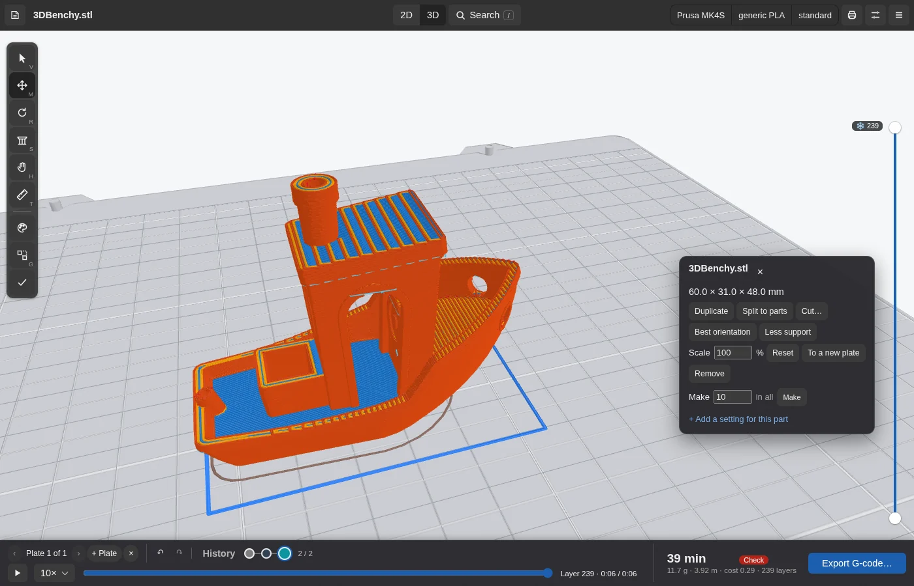
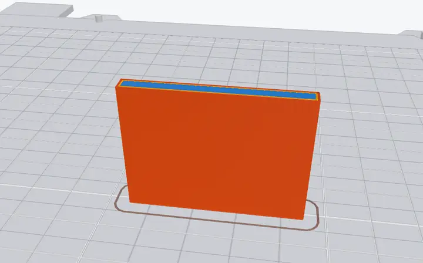

# Place the parts

Move, turn, scale, and cut the parts on the bed. A part obeys physics: if it cannot stand, it falls over.

## Select a part

Click a part with the Move tool (M). With another tool, hold Ctrl and click. The card of the part opens:

| Button | What it does |
|---|---|
| **Duplicate** (D) | A copy at a free place, with the settings of the part. |
| **Split to parts** | Each separate body becomes a part. |
| **Cut…** | Cuts the part in two with a level plane. |
| **Best orientation**, **Less support** | Turns the part. |
| **Scale**, **Reset** | The scale in %, or the turn and the scale of the file. |
| **To a new plate** | Moves the part to a new plate. |
| **Remove** (Delete) | Removes the part. |
| **Make [10] in all** | Copies, until there are that many. |
| **+ Add a setting for this part** | A setting for this part only. |

Tab and Shift+Tab select the next part. Esc clears the selection.

## Move and turn

- **Move.** Drag the part with the Move tool. The arrow keys move it 1 mm (Shift: 10 mm).
- **Turn on the bed.** Turn the wheel over the part with the Move tool: 15° for each step.
- **Turn about any axis.** Press R. Drag a ring: red turns about X, green about Y, blue about Z.

## A part falls over

After a turn, zslice checks if the part can stand. If its center of mass is past its foot, the part falls onto a face, as on a real bed. A note says so. With support on, the support holds the part, and it stays as you turned it.

## Grab a part

Press H for the Grab tool. Then:

1. Click a part to pick it up.
2. Move the pointer to carry it. The wheel lifts it. Alt and a move turn it (Shift: steps of 15°).
3. Click again, or press Esc, to let go. With support off, the part falls and rests flat. With support on, it keeps its turn.

## Placement

Right-click a part, then **Placement**:

- **Smart placement**: the least support, the most area on the bed, and a low height.
- **Less support**: the least support only.
- **Strong along X, Y, or Z of the part**: a print is weakest across its layers. So the part turns until that axis lies in the layers.
- **Put this side on the bed**: the side at the click goes down.

Right-click the empty view for **Arrange the plate**.

## Cut a part

1. Select the part, and click **Cut…**.
2. Set the height of the cut. An orange plane shows it.
3. Keep **Turn the top over** on: the top prints on its flat cut face.
4. Keep **Pegs to line up the parts** on, and pick the count and the size.
5. Click **Cut**.

After the print, glue the pegs into the holes of one part, and press the other part on.

## Where to go next

- → [Add support](support.md): support from the settings, or where you click.
- → [Plates and files](plates.md): more plates, and the project file.
