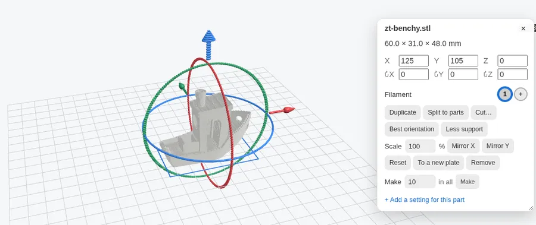

# Place the parts

Move, lift, turn, scale, and cut the parts on the bed. A part obeys physics: if it cannot stand, it falls over.

## Select a part

Click a part with the Move tool (M; R and G also pick it). With another tool, hold Ctrl and click. The gizmo shows on the part, and the card of the part opens next to it. The card shows the size of the part and its pose: **X** and **Y** (the place of its center), **Z** (the lift), and **↻X**, **↻Y**, **↻Z** (the turns about the axes of the bed). Type a value and press Enter. The card also has these actions:

| Button | What it does |
|---|---|
| **Duplicate** (D) | A copy at a free place, with the settings of the part. |
| **Split to parts** | Each separate body becomes a part. |
| **Cut…** | Cuts the part in two with a level plane. |
| **Best orientation**, **Less support** | Turns the part. |
| **Mirror X**, **Mirror Y** | Mirrors the part from left to right, or from front to back. The part stays at its place. |
| **Scale**, **Reset** | The scale in %, or the turn and the scale of the file. |
| **To a new plate** | Moves the part to a new plate. |
| **Remove** (Delete) | Removes the part. |
| **Make [10] in all** | Copies, until there are that many. |
| **+ Add a setting for this part** | A setting for this part only. |

Tab and Shift+Tab select the next part. Esc clears the selection.

## Select several parts

Hold Shift and click a part to add it to the selection. Shift and a click on a selected part takes it out. Each selected part has a blue box on the bed. The card shows how many parts there are, and the actions for all of them:

| Button | What it does |
|---|---|
| **Duplicate** (D) | A copy of each part. The copies are the new selection. |
| **Arrange the plate** | Puts all the parts of the plate in rows. |
| **To a new plate** | Moves the parts to one new plate. |
| **Remove** (Delete) | Removes the parts. |
| **+ Add a setting for these parts** | A setting for each of the parts. |

To move them all, drag one of them with the Move tool (or Ctrl and a drag), or press the arrow keys. Each action is one step of the history: Ctrl+Z undoes it.

## Move, lift, and turn

The Move tool puts a gizmo on the selected part. The view moves the part on each frame of a drag, and the slice follows it.

- **Move on the bed.** Drag the part itself. Its edges and its center snap to the edges and the centers of the other parts, and to the center of the bed. Thin magenta lines show the snap. Hold Shift for no snap. The arrow keys move the part 1 mm (Shift: 10 mm).
- **Move along an axis.** Drag the red arrow (X) or the green arrow (Y).
- **Lift.** Drag the blue arrow (Z), or press Page Up and Page Down (1 mm, Shift: 10 mm). The label shows the lift. A lift near 0 snaps to the bed.
- **Turn.** Drag a ring: red turns the part about X, green about Y, blue about Z. A turn goes in steps of 15° (Shift: 1°), and the label shows the angle. The keys: [ and ] turn about Z, Ctrl+↑ and Ctrl+↓ about X, Ctrl+← and Ctrl+→ about Y. The wheel over the view turns the part 15° on the bed.

The part never goes through the bed. A turn keeps the lowest point of the part on the bed, or at its lift. Each drag is one step of the history: Ctrl+Z undoes it.

### A part over the bed

Lift a part up, and it floats over the bed:

- With support on, it prints on support. The support grows from the bed up to the part.
- With support off, nothing holds the part. When the drag ends, the part falls to the bed, and a note says why.

### A part in the bed

Lift a part down, and it sinks into the bed. The slice starts at the bed, so the part under the bed does not print. The first layer is the section of the part at the bed: a flat face. Use it to cut off the bottom of a part, or to give a round part a flat base. At least 0.5 mm of the part stays over the bed. PrusaSlicer and OrcaSlicer let a part sink in the same way.

## A part falls over

After a turn, zslice checks if the part can stand while it prints. The first layer and the brim stick to the bed, and the nozzle pushes on the top of the part from the side. If the bond of the first layer cannot hold the part against this push and its weight, the part falls onto a face, as on a real bed. A note says so. A brim makes the bond larger: a tall thin part that falls with no brim can stand with one, and the Check list says that the brim holds it. With support on, the support holds the part, and it stays as you turned it. A drag of the part ends in the same way: it rests flat, unless support holds it.

A project, a 3MF file, and the plate after a reload keep each part as you saved it, with its lift. An open does not make a part fall.

## Placement

Right-click a part, then **Placement**:

- **Smart placement**: the least support, the most area on the bed, and a low height.
- **Less support**: the least support only.
- **Strong along X, Y, or Z of the part**: a print is weakest across its layers. So the part turns until that axis lies in the layers.
- **Put this side on the bed**: the side at the click goes down.

Right-click the empty view for **Arrange the plate**. The main menu also has **Smart placement**, **Arrange the plate**, and **Clear the plate** for all parts of the plate.

## Cut a part

1. Select the part, and click **Cut…**.
2. Set the height of the cut. An orange plane shows it.
3. Keep **Turn the top over** on: the top prints on its flat cut face.
4. Keep **Pegs to line up the parts** on, and pick the count and the size.
5. Click **Cut**.

After the print, glue the pegs into the holes of one part, and press the other part on.

## Print with more than one filament

A plate can have more than one filament. Each filament has its own material and color, and the view shows each line in the color of its filament.

1. Click the print time at the bottom right. The card lists the filaments of the plate.
2. Click **+ Add a filament**. Click its color to pick another color, and pick its material.
3. Give a part a filament: select the part, and click a color chip on the **Filament** row of its card.
4. Give some layers a filament: drag over the layers with the Select tool, and click a color chip on the **Filament** row of the card of the layers.

The G-code changes the filament where it changes. Set how the printer does this in the printer settings (**Filament change**):

- **pause**: the printer has one filament path. The print pauses (M600, or PAUSE on Klipper), and you change the filament.
- **tool**: a unit feeds many filaments (a Bambu Lab AMS, a Prusa MMU). The G-code has a tool change (T0, T1, …), and the nozzle flushes the old color out.

### Paint a part

The Paint tool (**P**) paints filaments on the surface of a part. In the web app, the view shows all parts of the plate at their places, in the colors of their paint.

1. Press **P**. In the web app, you do not have to select a part first. A click paints the part under the pointer, and the Inspector shows the name of that part. In the Linux, Mac, and Windows apps, the tool paints the selected part, or the first part if none is selected.
2. Click a filament chip on the card.
3. Paint:
   - **Smart select**: move the pointer over the part. The region under it lights up. Click to paint it. A raised letter or a logo is one region: its top and its sides. A flat face or a smooth surface is one region too. Shift and a click add more regions; a click on another chip then paints all of them.
   - **Brush**: drag over the surface. The size sets the radius of the brush. The edge of the brush splits the triangles under it, so the border is clean. A stroke stays on the part where it starts.
4. Right drag turns the view, and a middle drag pans. Press **P** or **Esc** to close the tool.

**Remove all paint** on the card gives the whole active part its own filament again. The active part is the part that you painted last, and the Inspector names it. Each click or stroke is one step of the history, so **Ctrl+Z** takes back the last one.

The web app, the Linux app, and the Mac app all have the Paint tool. In the Linux app, the part card of a painted part shows a chip for each filament of its paint, and its **Paint** button opens the tool on the part.

Each click or stroke slices again. Each region of a layer prints with its own walls and infill in its filament. A painted top face prints its color in its top layers.

A 3MF file keeps the paint. Painted models from MakerWorld (Bambu Studio) and Printables (PrusaSlicer) open with their colors and filaments.

### The prime tower, the check, and Bambu Lab

With **tool**, a prime tower stands next to the parts (back right, or at **Prime tower x** and **y**): after each change the nozzle flushes the old color into it, and it grows with the print up to the last change. The Bambu Lab X2D profile has the filament change G-code of Bambu Lab: its AMS flushes into the chute, and the tower gets a small prime. Export makes a `.gcode.3mf` file for a Bambu Lab printer, with the filaments of the print. **Print** sends this file to the printer through a printdeck.

The check (the check mark in the tools) warns about a painted region narrower than a line, about a prime tower off the bed or on a part, and about many changes or long change time.

The card shows the grams of each filament and the number of changes. A level with parts of many filaments prints the filament in the nozzle first, so it changes the filament at most once for each filament on it.

## Where to go next

- → [Add support](support.md): support from the settings, or where you click.
- → [Plates and files](plates.md): more plates, and the project file.
