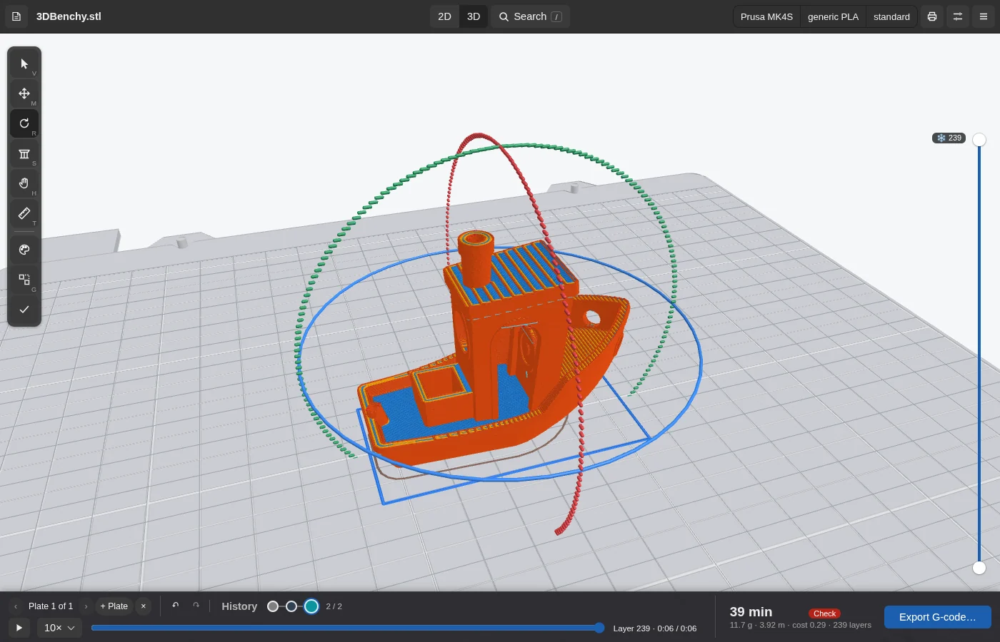

# Place the parts

Move, turn, scale, and cut the parts on the bed. A part obeys physics: if it cannot stand, it falls over.

## Select a part

Click a part with the Move tool (M). With another tool, hold Ctrl and click. The card of the part opens:

| Button | What it does |
|---|---|
| **Duplicate** (D) | A copy at a free place, with the settings of the part. |
| **Split to parts** | Each separate body becomes a part. |
| **Cut…** | Cuts the part in two with a level plane. |
| **Best orientation**, **Less support** | Turns the part. |
| **Scale**, **Reset** | The scale in %, or the turn and the scale of the file. |
| **To a new plate** | Moves the part to a new plate. |
| **Remove** (Delete) | Removes the part. |
| **Make [10] in all** | Copies, until there are that many. |
| **+ Add a setting for this part** | A setting for this part only. |

Tab and Shift+Tab select the next part. Esc clears the selection.

## Select several parts

Hold Shift and click a part to add it to the selection. Shift and a click on a selected part takes it out. Each selected part has a blue box on the bed. The card shows how many parts there are, and the actions for all of them:

| Button | What it does |
|---|---|
| **Duplicate** (D) | A copy of each part. The copies are the new selection. |
| **Arrange the plate** | Puts all the parts of the plate in rows. |
| **To a new plate** | Moves the parts to one new plate. |
| **Remove** (Delete) | Removes the parts. |
| **+ Add a setting for these parts** | A setting for each of the parts. |

To move them all, drag one of them with the Move tool (or Ctrl and a drag), or press the arrow keys. Each action is one step of the history: Ctrl+Z undoes it.

## Move and turn

- **Move.** Drag the part with the Move tool. The arrow keys move it 1 mm (Shift: 10 mm).
- **Turn on the bed.** Turn the wheel over the part with the Move tool: 15° for each step.
- **Turn about any axis.** Press R. Drag a ring: red turns about X, green about Y, blue about Z.

## A part falls over

After a turn, zslice checks if the part can stand while it prints. The first layer and the brim stick to the bed, and the nozzle pushes on the top of the part from the side. If the bond of the first layer cannot hold the part against this push and its weight, the part falls onto a face, as on a real bed. A note says so. A brim makes the bond larger: a tall thin part that falls with no brim can stand with one, and the Check list says that the brim holds it. With support on, the support holds the part, and it stays as you turned it.

## Grab a part

Press H for the Grab tool. Then:

1. Click a part to pick it up.
2. Move the pointer to carry it. The wheel lifts it. Alt and a move turn it (Shift: steps of 15°).
3. Click again, or press Esc, to let go. With support off, the part falls and rests flat. With support on, it keeps its turn.

## Placement

Right-click a part, then **Placement**:

- **Smart placement**: the least support, the most area on the bed, and a low height.
- **Less support**: the least support only.
- **Strong along X, Y, or Z of the part**: a print is weakest across its layers. So the part turns until that axis lies in the layers.
- **Put this side on the bed**: the side at the click goes down.

Right-click the empty view for **Arrange the plate**.

## Cut a part

1. Select the part, and click **Cut…**.
2. Set the height of the cut. An orange plane shows it.
3. Keep **Turn the top over** on: the top prints on its flat cut face.
4. Keep **Pegs to line up the parts** on, and pick the count and the size.
5. Click **Cut**.

After the print, glue the pegs into the holes of one part, and press the other part on.

## Print with more than one filament

A plate can have more than one filament. Each filament has its own material and color, and the view shows each line in the color of its filament.

1. Click the print time at the bottom right. The card lists the filaments of the plate.
2. Click **+ Add a filament**. Click its color to pick another color, and pick its material.
3. Give a part a filament: select the part, and click a color chip on the **Filament** row of its card.
4. Give some layers a filament: drag over the layers with the Select tool, and click a color chip on the **Filament** row of the card of the layers.

The G-code changes the filament where it changes. Set how the printer does this in the printer settings (**Filament change**):

- **pause**: the printer has one filament path. The print pauses (M600, or PAUSE on Klipper), and you change the filament.
- **tool**: a unit feeds many filaments (a Bambu Lab AMS, a Prusa MMU). The G-code has a tool change (T0, T1, …), and the nozzle flushes the old color out.

The card shows the grams of each filament and the number of changes. A level with parts of many filaments prints the filament in the nozzle first, so it changes the filament at most once for each filament on it.

## Where to go next

- → [Add support](support.md): support from the settings, or where you click.
- → [Plates and files](plates.md): more plates, and the project file.
