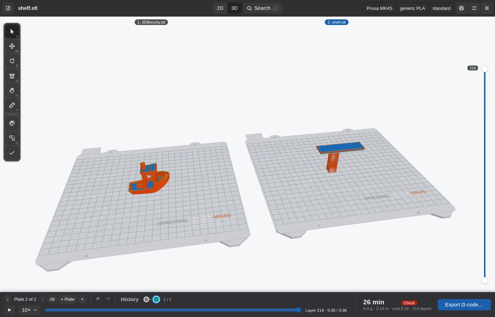

# Plates and files

Put the parts on more than one plate, and keep all plates in one project file.

## Plates

Each plate has its own parts, settings, support, and undo history. The dock has the plates:

| Button | What it does |
|---|---|
| ‹ and › | The plate before, and the next plate. `[` and `]` do the same. |
| **All** (Home) | Shows all plates in a row. F shows the active plate. |
| **+ Plate** | Adds an empty plate, with the settings of the active plate. |
| **×** | Removes the active plate. A plate with parts asks first. |

A sign lies on the table in front of each plate. It gives the number and the name of the plate, its printer, and its status. After a slice, it gives the print time and the filament. The sign turns with the view, and the parts hide it. A click on a sign goes to its plate. A right click on a sign on the web gives its menu.

An empty plate has a small **Open a model** button on the plate.

All plates slice: the active plate first. With two plates or more, the print card gives the sums of all plates.

**Make [10] in all** on the card of a part makes copies until there are that many: on its plate while they fit, then on new plates.

## One part at a time

Set `project.print_sequence` to `by_object` to print the parts of a plate one at a time. zslice prints one part from the bottom to the top, then the next part. A part that fails then stops only itself, and no strings go from one part to another.

Between two parts, the head goes up over the parts that it printed, moves over the next part, and goes down to the bed. Each part starts with the fan off, as the first layer of a print.

The parts print in the order of the plate list. The card of a part shows its place, for example **Prints 2 of 3**. Click **Print earlier** or **Print later** to move it in the list.

The print head has a size. Two settings of the printer give it:

- `machine.clearance_radius`: the radius around the nozzle that the head, its fans, and its probe fill. **Arrange the plate** keeps the parts this far apart.
- `machine.clearance_height`: the height from the tip of the nozzle to the lowest part of the gantry. Only the last part can be higher.

The defaults are 40 mm. Measure your printer, or take the values of its profile in PrusaSlicer or OrcaSlicer. The Check lists two parts that are too near, and a part that is too high and does not print last, with their names. The Check uses the box of each part from above, so a round part can be nearer than the Check says.

One part at a time has no prime tower. The layer slider and the replay show the parts in their order.

## Save and open

- **Save project…** (Ctrl+S, in the main menu) writes all plates into one 3MF file: the parts, their places, their settings, the support areas, and the edits of the lines.
- **Open…** (Ctrl+O) opens an STL, 3MF, OBJ, or STEP file (`.step`, `.stp`). An OBJ file has no unit: zslice reads it in mm. A STEP file from a CAD program becomes a mesh with chords within 0.01 mm of the true surface. zslice reads its solids, and not the places of the parts of an assembly. Another slicer opens a zslice 3MF as its first plate.
- zslice opens the 3MF files of other slicers. Parts that touch in the file stay one part.

## Cura projects

zslice opens a 3MF project that Cura saved, with the settings of each object:

- Each Cura setting becomes its zslice setting, for example `infill_sparse_density` becomes `project.infill_density`.
- A Cura "infill mesh" changes the infill of the part that it overlaps. This is how a speaker grille works.
- zslice does not support the cutting meshes, the anti overhang meshes, and the support meshes of Cura yet.

The card of the part lists the Cura settings, each with the zslice setting that it becomes.

## Where to go next

- → [Send to a printer](printers.md): print the plates.
- → [printdeck projects](projects.md): open a repository of parts to print.
