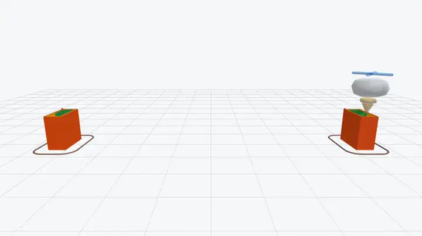
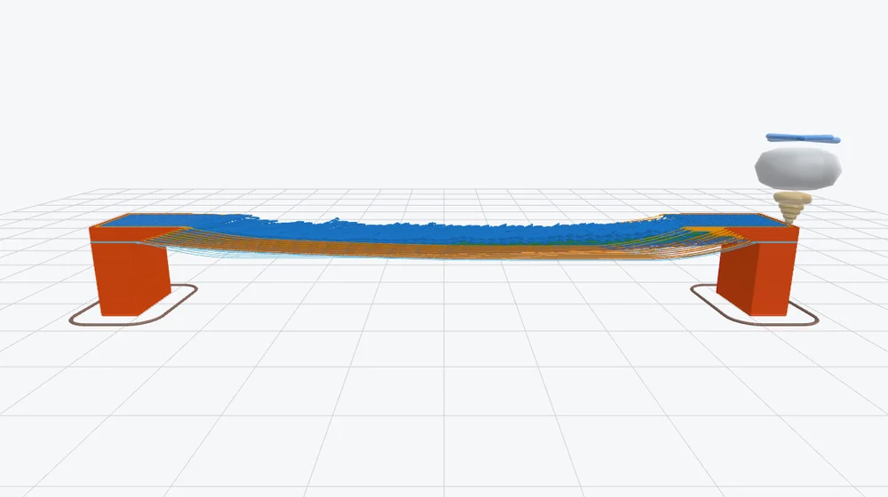
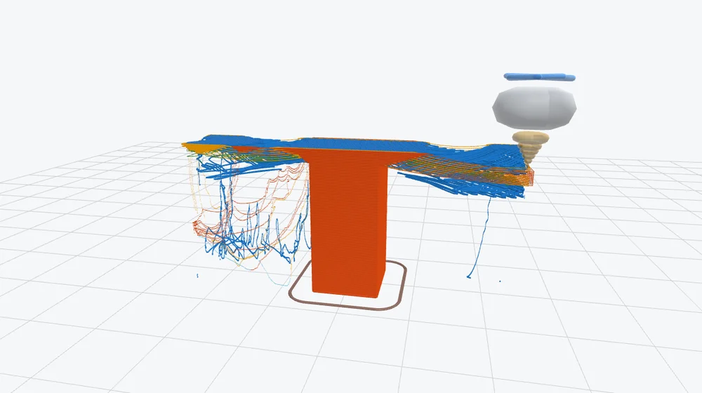

# The print as it forms

See the plastic as the printer lays it. A bridge sags. A slab over the air falls in strands, and the next layers print on them.

## Turn it on

1. Slice the part.
2. Open the colors menu in the tool strip, and click its last item: **The print as it forms (simulated plastic)**.
3. A note says how much of the plastic does not stay where it prints, and how far it moves.
4. Press ▶ on the dock to replay the print, or drag the layer slider.

A new slice shows the plan again. Turn the simulation on again after a change.

## A bridge sags

- The plastic between two held ends hangs as a chain. It creeps down while it is hot, and stops as it cools.
- More fan cools it faster, so it sags less. A hotter nozzle or a longer span sags more.

## A slab in the air falls

- Plastic with no hold under it swings and falls, until it touches the bed or solid plastic.
- The next layers print on the strands, where they set.
- Turn on support, or turn the part, and slice again.

## What it knows

| It knows | It does not know yet |
|---|---|
| The time at which each bit of plastic leaves the nozzle | Strands that bend: a hot strand that hangs from one end hangs straight down |
| How the plastic cools, in still air and with the fan | Strands that touch each other |
| How thick PLA gets as it cools, until it sets | Other materials than PLA |
| Where the bed and earlier layers hold the plastic | A set strand that bends later under the layers on it |

A 3DBenchy simulates in about 1.5 s on one core. The physics, with the numbers, is in [The print simulation](../internals/print-sim.md).

## Where to go next

- → [Add support](support.md): hold up what falls.
- → [Check the print](check.md): the list of overhangs and bridges.
- → [The best features](features.md): parts with real physics, and more.
