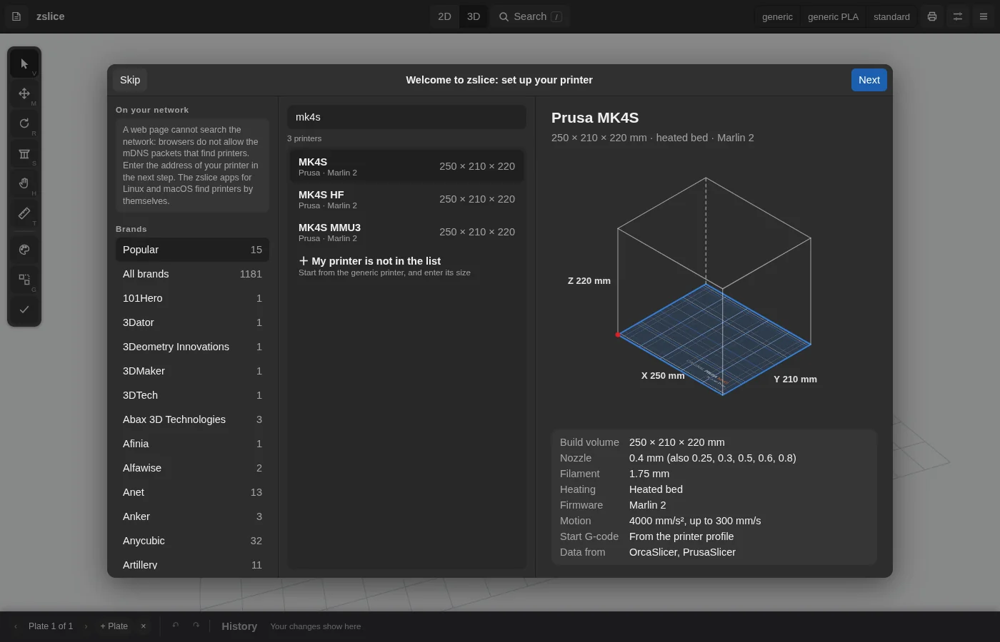

# Send to a printer

Add your printer once. Then **Print** sends each plate to it, signed.

## Add a printer

1. Pick **Add a printer…** at the end of the printer menu.
2. Type a part of a name: "ender 3", "mk4", "voron 2.4". Or pick a brand at the left.
3. Click a model. Its card draws its build volume to scale. The red dot is X0 Y0 of the G-code.
4. Click **Next**. Check the name, the nozzle, the filament, and the size. Set the connection.
5. Click **Add printer**.

The library comes from the printer definitions of Cura, PrusaSlicer, and OrcaSlicer. Not in the list? Pick **My printer is not in the list**, and enter its size.

## Connect a printdeck

A printdeck can drive many printers. Connect to it once:

1. Pick **Connect a printdeck…** in the printer menu.
2. Type the address of the printdeck. A secure address (`https://….d.printdeck.beetlebug.org`, on its System page) works from the web app in any browser.
3. Tap **Allow** on the screen of the printdeck.
4. Tick the printers to add, and click **Add**.

Each printer gets its own address on the printdeck, its name, and the profile of its model. zslice checks the address before each send: it refuses a send to an address that leads to another printer of the printdeck.

A send counts only when the printer stored the file. Any other answer shows as an error, with the address and the start of the answer.

## Connections

| Connection | What you need |
|---|---|
| None | Export a G-code file, and copy it to the printer. |
| printdeck, OctoPrint | The address of the printer. zslice gets its API key: tap Allow on the printer. |
| Moonraker (Klipper) | The address of Moonraker. |
| USB (Linux app) | The serial port and the speed. The computer must stay on while it prints. |
| Bambu Lab (LAN mode) | The IP address, the serial number, and the access code. The Linux app reads the status and the camera; the Mac app also sends prints (see [The macOS app](macos.md)). |

When you add a printdeck or an OctoPrint printer, zslice asks it for a key at once. A printer whose key stops working shows **Get a key** on its card on the Printers page. **Get a key** asks the printer for a key. The printer asks you to allow zslice: on its screen (printdeck), or in its web page (OctoPrint, with the App Keys plugin). Allow it within 2 minutes. Check that the printer shows the same key id as zslice.

The Linux and Mac apps find printers on your network. The web app cannot: enter the address. A printdeck with a secure address (`https://….d.printdeck.beetlebug.org`, on its System page) works from the web app in any browser.

A printdeck that drives more than one printer lists them after you allow zslice, the one at the address of the printdeck too. Pick the ones to add. Each one uses the key of the deck.

### A Bambu Lab printer (Linux app)

1. On the printer, turn on **LAN Only Mode**, and **LAN Only Liveview** for the camera.
2. In **Preferences › Printers**, add a printer, and choose **Bambu Lab (LAN mode)**.
3. Enter its IP address. Click **Read** to get the serial number from the printer, or type it from the screen of the printer.
4. Enter the access code from the screen of the printer. zslice keeps it in `~/.config/zslice/bambu/<serial>.code`, readable only by you.

The printer has a certificate of its own. zslice trusts the certificate that it sees at the first connection, or when you click **Read**. Later, zslice sends the access code only to a printer with the same certificate: a device on the network that claims the address of the printer gets no code. After a reset of the printer, its certificate can change: click **Read** again to trust the new one.

zslice only reads a Bambu Lab printer: its status over MQTT, and its camera. It sends no command. The X1, H2, P2S, and X2D printers send their camera over RTSP, which needs GStreamer; the P1 and A1 printers send JPEG frames.

## The Printers page

Each printer has a card: its camera, its state, the job with its progress and the time left, the temperatures, and its roll. Click the camera to see it large. **Print the plate** sends the active plate after you confirm that the bed is clear. The menu of the card has **Upload the plate only** and the page of the printer. The plates of the project are at the top, each with a printer to send it to.

A camera plays only while its card is on the screen. The picture goes from the printer straight to zslice. In the web app, a camera on http does not play on the https page of zslice: open zslice from the printer, or give the printer an https address. While the printer of the plate prints, the details of the print (click the time) show its camera.

## What changes with the printer

Each printer keeps its own printer settings: the bed, the nozzle, the speed limits, and the accelerations. The acceleration of each feature is a printer setting too: `outer_wall_accel`, `inner_wall_accel`, `skin_accel`, `infill_accel`, `travel_accel`, and `first_layer_accel`. 0 means the `max_accel` of the printer. When you change the printer, these values change with it.

The print settings stay when you change the printer: the layer height, the walls, the infill, and the speed ratios.

Each printer also keeps the filament that you last used with it. When you change to another printer, zslice saves the filament settings for the printer before. When you change back, its filament comes back, and the Filament menu shows it. A printer with no saved filament keeps the filament that you have now. In the Linux app, the roll that a printer reports still wins: its settings load at the next status of the printer.

Before this version, the accelerations were print settings. At the first start of this version, zslice moves your saved values to the printer that you use then. Old projects and sessions load too: their accelerations go to the printer of the plate.

## Print

1. Pick the printer in the printer menu.
2. Click **Print** on the print card. Its menu also has **Upload only** and **Export G-code…**.
3. zslice asks if the bed is clear. Then the printer prints.

With a printdeck printer, the print card also gives the time that the printer predicts, from its past prints. The cost uses the price of the roll in the printer.

## Signed prints

Each G-code file that zslice exports or sends ends with a signature line. A printdeck prints a file only from an app that it trusts. **Get a key** gives the public key of the app to the printdeck. OctoPrint and Moonraker do not check signatures.

## The start and end G-code

Search `start gcode`. The editor spans the panel. Under it, each variable is a button: a click puts it at the cursor. **Show the result** shows the G-code of the last slice, with the values. Look at it before the first print on a new printer.

## Where to go next

- → [A print farm](farm.md): all your printers on one page.
- → [Undo and history](history.md): go back to any change.
