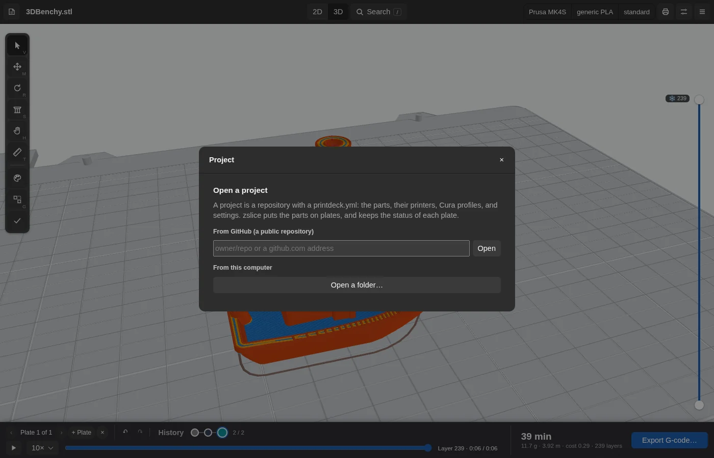

# printdeck projects

Open a repository of parts from GitHub. zslice puts the parts on plates, each with its printer, profile, and material.



A project is a repository with a `printdeck.yml` file at its root. The file lists the parts to print. printdeck uses the same file for its builds from GitHub.

## Open a project

1. In the web app or the Windows app, pick **Open a project…** in the main menu.
2. Type `owner/repo`, or the address of a repository on github.com, and click **Open**. An address with `/tree/<branch>` opens that branch. The repository must be public.
3. Or click **Open a folder…**, and pick the folder of the repository on your computer.

The dialog shows the parts and the plates of the project. The app reads only the files that a plate needs, when you open the plate.

## Pick the parts

- Each part has a check box and a count. Clear the box to leave the part out.
- The parts with the same printer, profile, material, and plate settings share a plate.
- A part with `alone: true` gets a plate of its own.
- A part with variants (for example fine and fast) is one part for each variant. Only the first variant is on at the start.

## Print a plate

1. Click **Open** on a plate. zslice loads all plates of the project, each with its own profiles, and slices them. The plate that you clicked becomes the active plate. Then **Show** goes to a plate.
2. Export the G-code, or send it. If one of your printers has the name of the printer of the plate (for example `taz`), zslice picks it.
3. Set the status of the plate: **To print**, **Printing**, **Printed**, or **Failed**. A send from the plate sets **Printing**.

The machine settings of the plate come from the project. They do not change the profile of your printer. A plate with no Cura stack is a resin plate: zslice does not slice resin yet.

The project and the status of its plates stay after a reload. The web app keeps them in your browser. Open a folder again after a reload. **Close** closes the project. Its plates stay in the view, and their print status goes.

## printdeck.yml

```yaml
project: robot
parts:
  - name: Feet
    group: Legs
    files: [models/foot.stl]
    count: 4
    printer: taz
    profile: taz-workhorse-se/pla-0.20-standard   # profiles/<folder>/ and a profile of its cura.json
    material: roll-4                               # a material of that cura.json
    settings: {support_enable: false, adhesion_type: brim, brim_line_count: 10}
  - name: Tower
    files: [models/tower.stl]
    printer: taz
    profile: taz-workhorse-se/pla-0.20-standard
    material: roll-4
    alone: true
    variants:
      - name: fine
        profile: taz-workhorse-se/pla-0.10-fine
      - name: fast
        settings: {infill_sparse_density: 10}
```

The settings use the names of Cura. A setting that zslice cannot use stops the load of the plate, with the reason.

## Privacy

To open a GitHub project, the app reads the repository from `api.github.com` and `raw.githubusercontent.com` (and `media.githubusercontent.com` for a file in Git LFS). It sends no login and no data of yours. See [Privacy](../../PRIVACY.md).

## Where to go next

- → [A print farm](farm.md): send the plates to your printers.
- → [Plates and files](plates.md): the plates on the dock.
