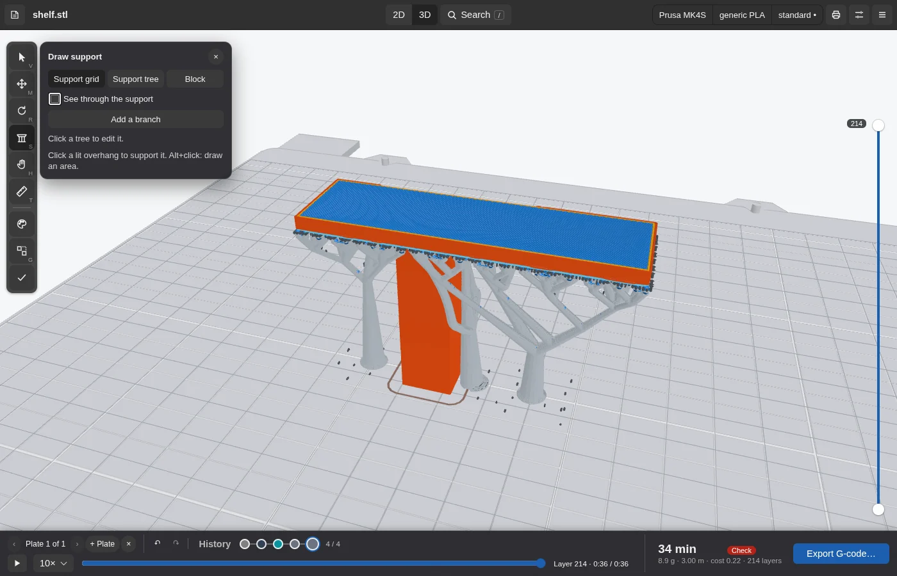
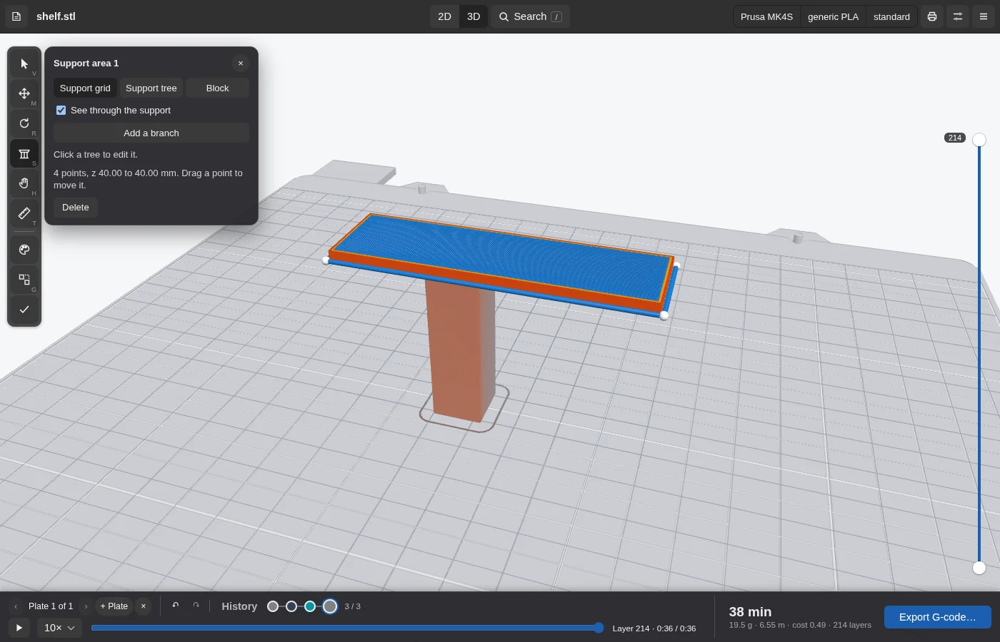

# Add support

Turn support on in the settings, or click where you want it. Then drag the branches of the trees.

## Support from the settings

1. Type `support` in the search, or click **Turn on support** on the print card.
2. Pick the **Support style**:
   - **grid**: straight walls under each overhang, with interface layers on top;
   - **tree**: branches from the bed to each overhang. A branch gets wider on the way down, so it can stand. It prints hollow.
3. `project.support_angle` sets how flat an overhang must be to get support.

## Click where you want support

1. Press S for the Support tool. Its card opens at the top left.
2. Point at an overhang. It lights up.
3. Click. Support grows under it, also with support off.
4. Pick the kind on the card: **Support grid**, **Support tree**, or **Block** (no support there).

To draw an area point by point, hold Alt and click points around it. Click the first point again, or press Enter, to close it. Backspace removes the last point. Esc stops.

To change an area:

- click its outline to select it;
- drag a point: the outline follows the pointer, and the plate slices when you let go;
- press Delete to remove it.

**Tip:** The support lines are faint while the tool is on, so the outlines show. Clear **See through the support** on the card to see them solid.

## Edit the trees

With tree support, the Support tool shows the nodes of the trees as dots.

| Do this | What happens |
|---|---|
| Drag a dot | The node moves. |
| Drag the ring of a selected node | The branch gets wider or narrower there. |
| Drag a segment | The whole branch moves. |
| Press Delete | The branch goes, and the branches over it. |
| **Add a branch** | Tap a spot on the bed, then the place on the part that needs support. |
| **Reset support** | The trees of the part are planned again. |

zslice keeps each edit within the rules: out of the part, at most the tree angle, and at least the width that the branch needs. An edit that a rule limits turns red, and the card says why.

## Support marks

Right-click a line for **Add support here** › **Grid**, **Tree**, or **Bridge (a pad)**. **Block support here** keeps support out of that place.

The project file keeps the areas, the marks, and the edits of the trees. Ctrl+Z undoes each change.

## Where to go next

- → [Check the print](check.md): find the overhangs before you print.
- → [The print as it forms](print-as-it-forms.md): see what happens with no support.
